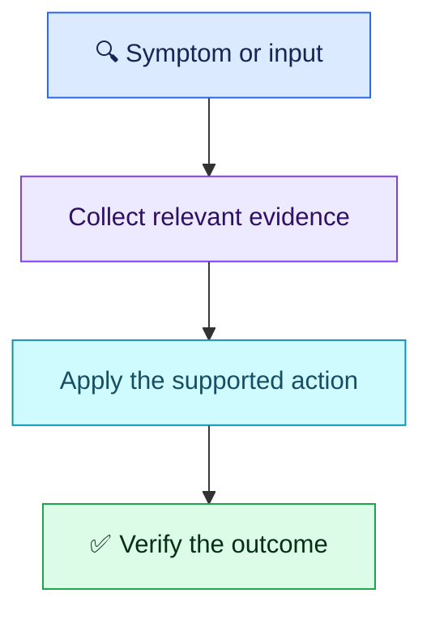
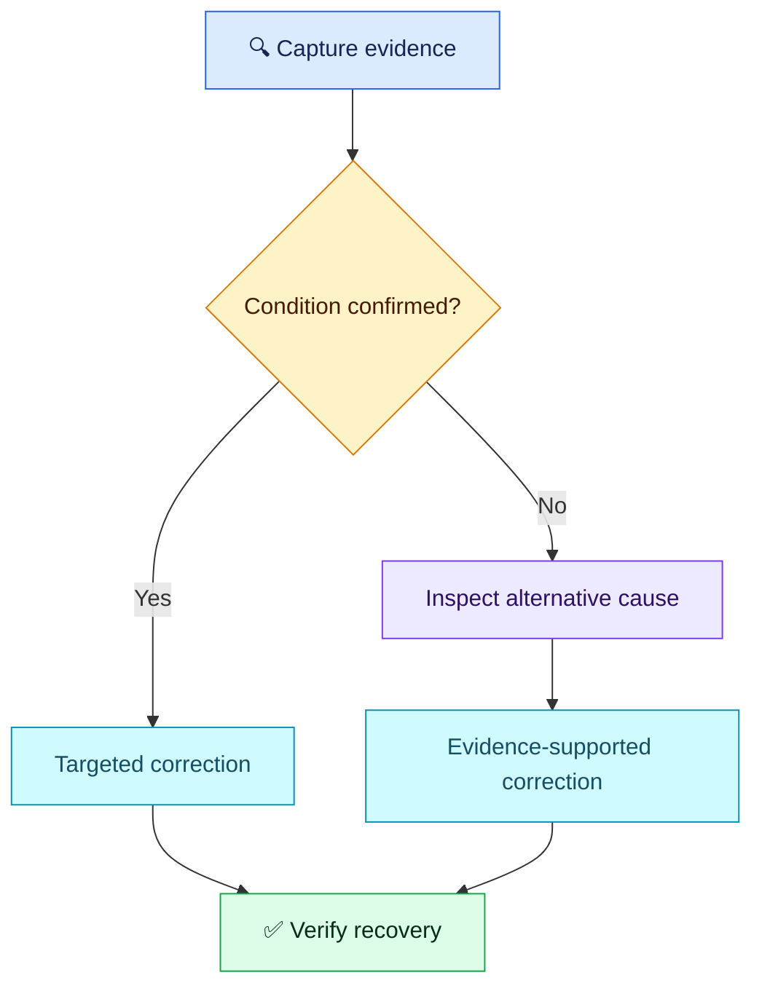
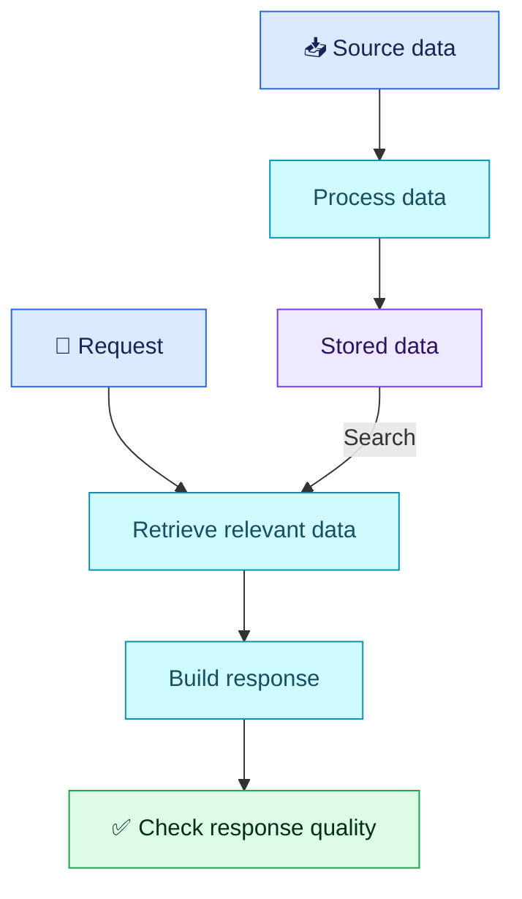

# Colorful Answer Flowchart Templates

Use these reusable Mermaid layouts for all topics. Copy a template, replace its labels and preserve the scenario's meaningful branches. View diagrams in a Mermaid-capable Markdown preview or on GitHub.

**Color key:** 🔵 starting point · 🟣 evidence · 🟡 decision · 🩵 action · 🟢 verified outcome · 🔴 risk/failure. Labels and shapes carry meaning even without color.

## 1. Linear steps

## 2. Troubleshooting branches

## 3. Stored-data pipeline

Keep labels short and quote node text. Use a diamond for a real decision; preserve Yes/No and failure routes. Add a red failure node only where the scenario needs one. Do not turn command examples, terminal output or plain explanatory arrows into flowcharts.
