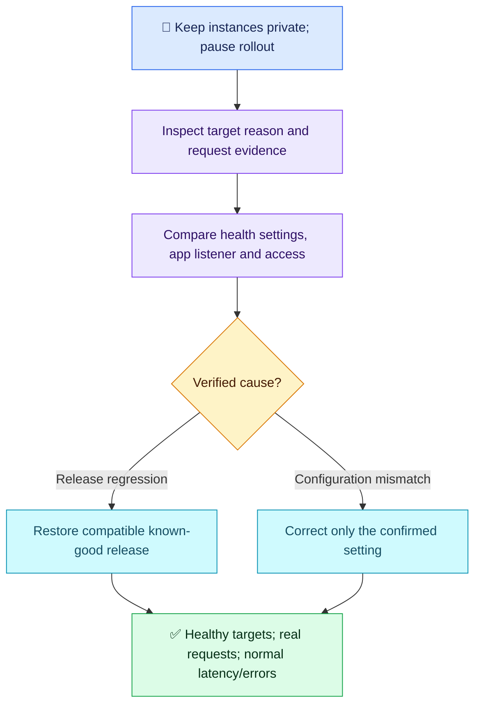

# AWS Q01 — Unhealthy ALB Targets After Deployment

## 🎯 Scenario

An internet-facing ALB fronts EC2 instances in private subnets across two AZs. Following deployment, users see HTTP 503; EC2 status checks pass but all targets are unhealthy. A teammate proposes public IPs and all inbound ports. Diagnose, restore and verify safely.

## ✅ Interview-ready answer

“I would keep instances private and stop the faulty rollout. EC2 status checks do not prove application health. I would inspect target-health reasons and the deployed changes, compare the target port/protocol and health-check path/matcher with the application's listener and actual response, and check the ALB-to-target access rules. If the release caused the outage, I would restore the known-good release or correct the verified mismatch, then confirm healthy targets and successful requests through the ALB across both AZs.”

## 🔎 Essential evidence and action

| Check | Purpose and decision |
| --- | --- |
| Target group health reason/description | Distinguish timeout, response-code mismatch and connection failure; inspect health-check logs if enabled. |
| Target registration, listener rule, health port/protocol/path/matcher | Confirm requests reach the intended group and the check matches the real application contract. Do not simply accept error codes to make targets green. |
| Instance listener and app logs | Confirm the service is listening on the expected reachable interface/port; correlate failures with the release. |
| Network access | Instance SG permits application/health-check ports from the ALB SG; ALB egress permits them. Check restrictive NACLs and return traffic if evidence suggests a network failure. Public instance IPs are unnecessary. |
| Recovery | Pause rollout; rollback safely if release-related, accounting for data/schema compatibility, or correct the confirmed setting. Restore healthy capacity without opening all ports. |
| Verification | Healthy targets in both AZs, successful real requests via ALB, error rates and latency back to baseline under representative traffic. |

Illustrative host checks through an approved private access method such as Session Manager; replace service/port/path:

```bash
sudo ss -tulpn
sudo journalctl -u myapp --since "15 minutes ago"
curl -i http://127.0.0.1:8080/health
```

These confirm listener, recent errors and local HTTP response. Local success alone does not prove ALB reachability.

**Scenario clarification:** all targets unhealthy does not itself prove that ALB generated the 503. ALB can fail open to unhealthy registered targets. Use access-log `elb_status_code`/`target_status_code` and ALB-versus-target error metrics to distinguish origin; inspect routing/registration if ALB generated it. The question did not specify the error origin, so this nuance is coaching, not a scoring deduction. Deployment timing suggests a regression but does not prove infrastructure/configuration stayed unchanged.



## Evaluation — 2026-10-18

**7/10 — Sound diagnosis and isolation; restoration and verification incomplete.** Interview Acceptance Probability: **65%**, subjective answer-specific coaching, not a hiring prediction. Four-year baseline.

**Attempt summary:** Rejected public IPs/all inbound ports, retained private instances, correlated failure with deployment, proposed wrong listener port or changed health path, target-health logs/status and journalctl/ss. Asserted no infrastructure changes; did not specify a recovery action or success criteria. Opening wording is interpreted from the explicit rejection that follows, not as a proposal to expose instances.

**Credit:** Strong security judgment and relevant application/ALB diagnosis. Linux checks are valid AWS incident evidence; no penalty for keeping command discussion brief. Target-health inspection receives credit without demanding exact reason-code names.

**Deductions:** 1 missing concrete restoration/rollback; 1 missing target-health and real-request recovery verification; 1 combined for ruling out infrastructure without evidence and omitting the specific ALB-to-instance access check. No deduction for the question's ambiguous 503 origin or advanced details.

**Cross-topic observability:** service-health reasoning improves on Kubernetes Q08's Running-means-healthy assumption; cause still needs evidence. Recovery verification remains unresolved relative to Linux Q03/Q04/Q10. No separate numeric observability score or duplicate question count.

## Sources

- [AWS: target health checks and fail-open behavior](https://docs.aws.amazon.com/elasticloadbalancing/latest/application/target-group-health-checks.html)
- [AWS: target-health reason codes](https://docs.aws.amazon.com/elasticloadbalancing/latest/application/check-target-health.html)
- [AWS: ALB troubleshooting and HTTP errors](https://docs.aws.amazon.com/elasticloadbalancing/latest/application/load-balancer-troubleshooting.html)
