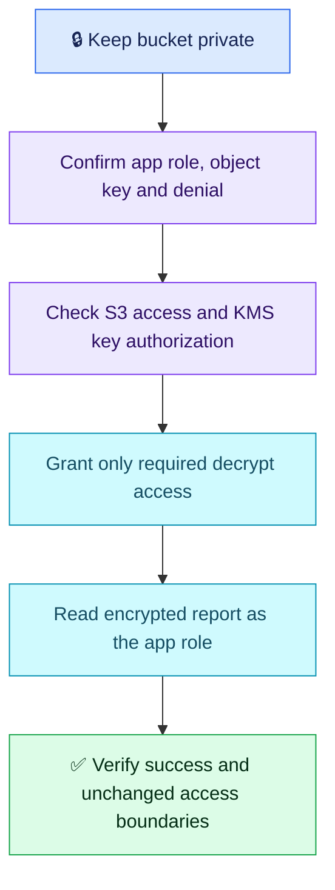

# AWS Q02 — S3 AccessDenied After KMS Encryption

## Scenario

An EC2 instance role can read a report prefix, but reads of new objects fail after adopting a customer-managed KMS key. The role still allows s3:GetObject. Diagnose and restore least-privilege access, then verify using the application's identity.

## Interview-ready answer

“I would keep the bucket private and identify the application's actual role, failing object and KMS key. I would inspect the access error and available CloudTrail evidence, then allow the role to decrypt with that specific key while checking that the key policy permits it. Existing S3 read access remains required. I would test an actual encrypted report read using the application's credentials and confirm successful retrieval without broadening unrelated access.”

## Essential checks

- **Identity and evidence:** policies attach to the IAM role inside the instance profile. Confirm the credential chain is not using a different profile/static credential. Inspect the failing object's encryption/key metadata through authorized access and correlate application errors with KMS Decrypt events where recorded. S3 GetObject CloudTrail data events require configuration; do not assume they are in ordinary Event history.
- **Permissions:** keep s3:GetObject scoped to the report prefix; grant kms:Decrypt on the actual key ARN. The KMS key policy must authorize the role directly or enable IAM delegation. An IAM allow alone cannot overcome a blocking key policy or explicit deny. Check relevant bucket policy, SCP, permission boundary and endpoint policy only as applicable to the denial; verify key usability.
- **Server-side operation:** S3 handles decryption with KMS authorization; the application normally reads the object, not retrieves key material or manually decrypts it.
- **Prior encryption:** not using a customer-managed KMS key does not mean unencrypted. S3 automatically encrypts new uploads with SSE-S3 by default. Changing bucket defaults does not retroactively re-encrypt existing objects.

Illustrative checks from the application's credential context; substitute the bucket/key and an approved local destination. These commands are not executed here.

```bash
aws sts get-caller-identity
aws s3api get-object --bucket REPORT_BUCKET --key reports/test-report.csv ./test-report.csv
```

The first confirms the caller; the second proves a real object read/decryption. Do not test with administrator credentials and infer that the app works. Confirm the application's own retrieval success and falling AccessDenied counts under traffic. Check that unrelated objects remain inaccessible. Dashboards support this proof but do not replace identity-specific testing; separate dashboards are optional.



## Evaluation — 2026-10-18

**7/10. Interview Acceptance Probability: 65%**, subjective answer-specific coaching, not a hiring prediction. Four-year baseline.

**Attempt:** Rejected admin/public access, identified KMS decryption authorization in addition to object access, proposed updating the instance profile and checking retrieval success on application dashboards. Assumed objects had previously lacked server-side encryption. No specific denied-operation evidence, key-policy check or actual-role read test was described.

**Credit:** Correct central diagnosis, scoped-access intent, encryption awareness and explicit recovery signal. “Instance profile” versus its role is clarified without a separate deduction; decrypt intent receives credit without requiring exact action syntax.

**Deductions:** 1 missing key-policy authorization; 1 combined missing denial evidence and actual-identity read test; 0.5 unsupported unencrypted-before claim; 0.5 insufficiently explicit restriction to the actual key. No penalty for omitted policy JSON, advanced conditions or dashboard layout.

**Recovery comparison:** AWS Q01's missing restoration action is resolved for this scenario (add required key access). Recovery verification is partially improved: retrieval success is specified, but testing the exact object as the app role remains absent. Other Q01 networking/rollback gaps are not reassessed. Observability gets a qualitative link, not a duplicated numeric score.

## Sources

- [AWS: SSE-KMS authorization and operation](https://docs.aws.amazon.com/AmazonS3/latest/userguide/UsingKMSEncryption.html)
- [AWS: downloading KMS-encrypted objects](https://repost.aws/knowledge-center/decrypt-kms-encrypted-objects-s3)
- [AWS: default encryption](https://docs.aws.amazon.com/AmazonS3/latest/userguide/bucket-encryption.html)
