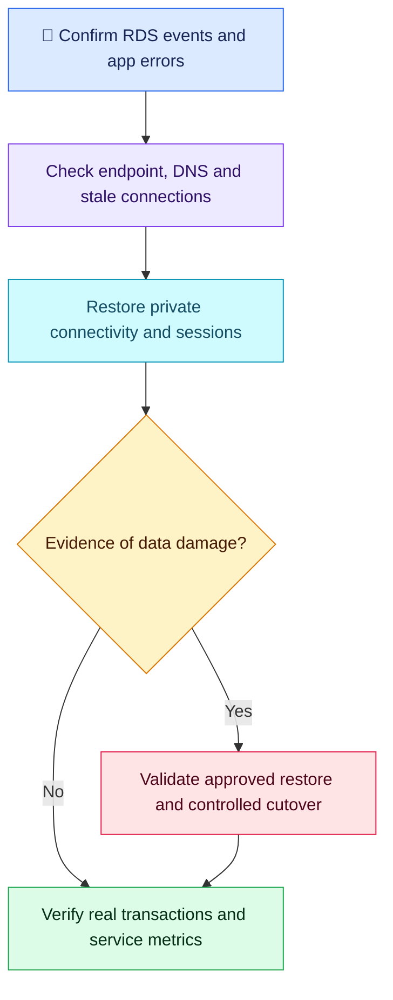

# AWS Q03 — Application Connections After RDS Failover

## 🎯 Scenario

An RDS PostgreSQL Multi-AZ DB instance has failed over successfully after an AZ disruption, but application connections still fail. A teammate proposes restoring last night's database snapshot and using the new primary IP. Restore connectivity safely, decide whether data recovery is needed and prove recovery.

## ✅ Interview-ready answer

“I would retain the RDS endpoint and inspect failover events and the application's exact connection errors. Multi-AZ maintains a synchronous standby in another AZ of the same Region. RDS changes the endpoint's DNS mapping, but existing connections do not migrate. I would check DNS resolution from the application and its runtime cache, renew stale pooled connections and verify access to the promoted database. Snapshot restoration is not a connectivity fix; I would first verify database health and application data, then test real transactions and monitor errors/latency.”

## 🔍 Diagnose, recover, verify

| Step | Essential evidence and action |
| --- | --- |
| Confirm failover | RDS events/status and application errors: timeout, stale connection, authentication or query failure require different fixes. |
| Endpoint and DNS | Use the configured RDS hostname, not a pinned IP. Check resolution from the app host and runtime. OS lookup success does not prove the application runtime refreshed its cache. |
| Connections | Reconnect invalid pooled sessions; use bounded retries/backoff and transaction-aware handling. If needed, recycle affected app instances gradually. Correct excessive DNS caching rather than repeatedly clearing unspecified caches. |
| Network path | Check database-port reachability from the app and applicable SG, routes/NACLs in the promoted AZ. Do not expose the database publicly. |
| Data decision | Synchronous replication protects committed data during normal failover; in-flight transactions can fail or have an uncertain outcome. Verify critical recent records/transactions before retrying writes to avoid duplicates. Replication does not protect against logical deletion/corruption. |
| Recovery proof | Execute representative application reads and a controlled write through the endpoint; verify results and connection-error/latency recovery under traffic. Dashboard health alone is insufficient. |

Illustrative commands from the app host; replace the endpoint. The example query is read-only; use approved credentials/TLS configuration without exposing passwords.

```bash
nslookup DB_ENDPOINT
nc -vz DB_ENDPOINT 5432
psql "host=DB_ENDPOINT port=5432 dbname=APP_DB user=APP_USER sslmode=verify-full sslrootcert=CA_FILE" -c "SELECT 1;"
```

DNS, TCP and an authenticated query test progressively different layers. A successful SELECT 1 does not establish business-data integrity. Traceroute may be filtered and does not prove database response time or connectivity.

**Snapshot precision:** the scenario concerns an RDS database snapshot, not an application snapshot. A restore creates another DB instance with data as of that recovery point; it is not an in-place connection repair. If actual data loss/corruption is established, evaluate approved point-in-time recovery or snapshot restoration against RPO, validate a separate restored instance and plan cutover. Multi-AZ is same-Region availability, not automatic cross-Region DR. This single-standby deployment does not serve reads from its standby before promotion.



## Evaluation — 2026-10-18

**7/10 — Correct endpoint/cache diagnosis; topology and connection recovery need precision.** Interview Acceptance Probability: **65%**, subjective answer-specific coaching, not a hiring prediction. Four-year baseline.

**Attempt:** Rejected snapshot/IP changes, explained automatic endpoint remapping and standby promotion, proposed DNS lookup/cache invalidation, mentioned traceroute and application dashboards. Described standby as in a DR Region and claimed no data-loss concern because of synchronization. Called the snapshot an application snapshot. No explicit stale-pool recovery, real query/write test or data-integrity decision was provided.

**Credit:** Relevant DNS diagnosis, stable-endpoint choice, synchronous standby concept, no standby reads before promotion and application-level recovery observation. No penalty for omitted advanced tooling or concise commands.

**Deductions:** 1 same-AZ/Region architecture correction (standby is another AZ in the same Region, not DR Region); 1 incomplete runtime DNS versus existing-connection recovery; 1 combined overbroad data-safety assertion and missing concrete transaction/data verification. Snapshot wording and traceroute limitations are clarified without additional deductions.

## Previous-gap recovery

- AWS Q01 mitigation: partially improved — cache invalidation is an action, but stale sessions/pool recovery remains unspecified.
- AWS Q01/Q02 verification: partially improved — application interaction/dashboard success is mentioned; an actual identity/path-specific transaction and explicit acceptance criteria remain missing.
- Other IAM/KMS and ALB-specific weaknesses: not reassessed. Keep historical scores and outstanding revision items.

## Sources

- [AWS: Multi-AZ DB instance topology](https://docs.aws.amazon.com/AmazonRDS/latest/UserGuide/Concepts.MultiAZSingleStandby.html)
- [AWS: failover and DNS caching](https://docs.aws.amazon.com/AmazonRDS/latest/UserGuide/Concepts.MultiAZ.Failover.html)
