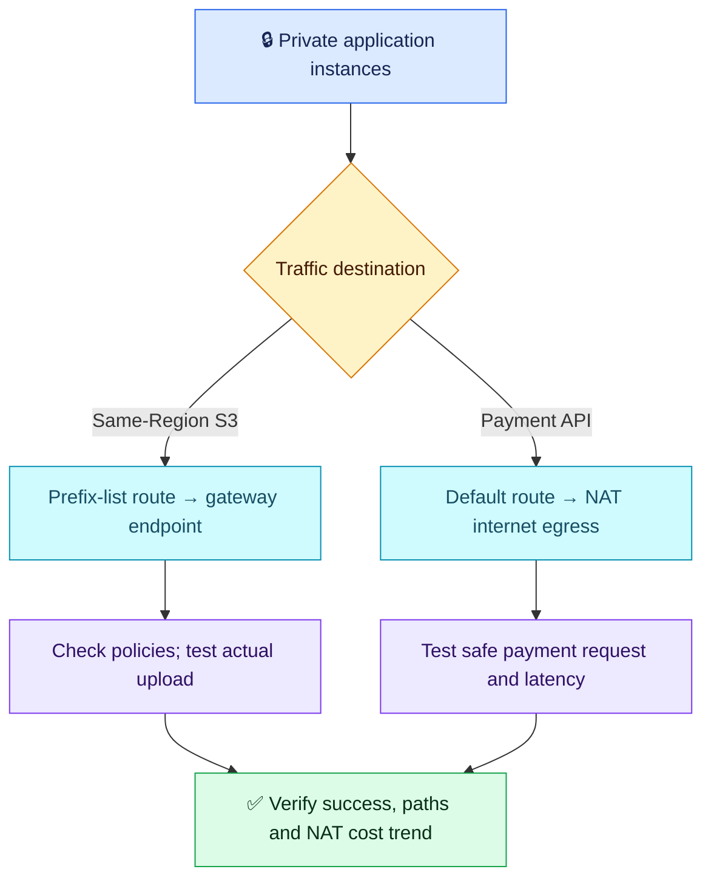

# AWS Q04 — S3 Endpoints and NAT Routing

## 🎯 Scenario

Private EC2 instances upload large files to same-Region S3 and call an external payment API. NAT costs are high; uploads fail during NAT outages. A teammate suggests replacing all NAT traffic with an S3 endpoint. Design routing/access and verify both paths.

## ✅ Interview-ready answer

“I would use an S3 gateway endpoint for this same-Region VPC workload and retain internet egress through NAT for the payment API. I would associate every relevant private-subnet route table with the endpoint, check the S3 prefix-list route and retain the default NAT route. I would validate endpoint, bucket and role permissions, then test uploads and safe payment requests from the application subnets. Reduced NAT traffic should confirm the cost benefit, while S3 access no longer depends on NAT.”

## Routing and access

| Destination | Private-subnet route | Check |
| --- | --- | --- |
| Regional S3 prefix list (`pl-...`) | S3 gateway endpoint (`vpce-...`) | Endpoint association adds the route; it wins over the less-specific default route. |
| Other IPv4 destinations (`0.0.0.0/0`) | Public NAT Gateway | NAT public-subnet route reaches the internet gateway; EC2 remains private. |

- Choose a **gateway** endpoint here; an S3 interface endpoint is another option for different connectivity needs, with different costs/configuration. The gateway endpoint has no additional endpoint charge; ordinary S3 charges remain.
- Check endpoint policy, bucket policy and role permissions for the required bucket/prefix/actions; retain applicable KMS authorization. An endpoint does not grant S3 permission or automatically enforce least privilege.
- Allow required HTTPS egress and NACL return traffic. Gateway endpoints have no attached security groups; instance egress can reference the S3 prefix list. Do not confuse this with interface-endpoint SGs.
- Retaining NAT alone does not resolve payment availability during a NAT outage. Review the actual egress architecture and failure domain; for a zonal NAT design, use appropriate per-AZ egress rather than a single shared dependency, balancing cost and availability.

## Prove the change

From each application subnet and using the app role, upload a harmless test object to an approved prefix and confirm it arrived. Execute a safe payment-provider test/non-charging request, checking the actual response and latency. Review upload/payment success and error rates, plus NAT byte trends and subsequent costs under comparable traffic. Confirm the route associations; dashboards alone do not prove which path was used.

Test S3 independence from NAT only in an isolated test subnet or approved failure exercise, not by removing production NAT routes. Schedule endpoint route changes carefully: existing S3 TCP connections can be interrupted; retain retries and a rollback plan.

**Security precision:** the endpoint removes the NAT/IGW dependency for this S3 path. “Most secure” is not a blanket guarantee; TLS and access policies still matter. Nor does using NAT imply AWS-to-S3 traffic necessarily traverses third-party internet networks.

## Evaluation — 2026-10-19

**7/10 — Correct traffic separation; routing and authorization details missing.** Interview Acceptance Probability: **65%**, subjective answer-specific coaching, not hiring probability. Four-year baseline.

**Attempt:** Rejected removing NAT for all destinations; described private S3 endpoint access, retained NAT for payment traffic, and proposed observing payment success/upload failures in dashboards. Called the endpoint the most secure option. No specific endpoint type, route-table association/routes or policy checks were described.

**Credit:** Correct architecture direction and service scope, reduced NAT dependency/load and explicit monitoring of both flows. No penalty for missing CLI commands.

**Deductions:** 1.5 combined missing gateway-endpoint selection and concrete route-table/prefix-list/default-route setup; 1 missing access-policy checks; 0.5 incomplete direct operation/path and cost verification. No additional deduction for advanced NAT resilience, security wording or optional failure tests.

**Recovery:** Q01–Q03 verification remains partially improved: both outcomes are named, but app-originated tests and evidence of the intended path are missing. Q01 network configuration and Q02 effective-access checking remain unresolved in this attempt. Other old gaps not reassessed. No observability subscore duplicated.

## Sources

- [AWS: S3 gateway endpoints, access and route changes](https://docs.aws.amazon.com/vpc/latest/privatelink/vpc-endpoints-s3.html)
- [AWS: gateway endpoints](https://docs.aws.amazon.com/vpc/latest/privatelink/gateway-endpoints.html)
- [AWS: routing examples](https://docs.aws.amazon.com/vpc/latest/userguide/route-table-options.html)
