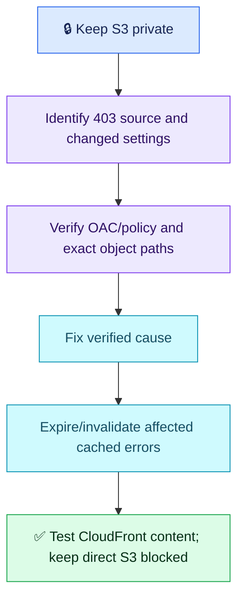

# AWS Q06 — CloudFront 403 with a Private S3 Origin

## 🎯 Scenario

After deployment, CloudFront returns 403 for the homepage and assets from a private S3 origin. Files exist and an administrator can read them. Diagnose and restore delivery without public access, then verify through CloudFront.

## ✅ Interview-ready answer

“I would retain Block Public Access, compare the deployment/configuration changes and identify whether the 403 originates at the edge or S3. Administrator access does not prove CloudFront authorization. For an S3 REST origin, I would verify the origin access control and a bucket policy allowing this distribution to read the required objects. I would also check the requested keys and origin path. After fixing the cause, I would invalidate affected cached errors if necessary, then test the homepage and assets through CloudFront and verify anonymous direct S3 access remains blocked.”

## 🔍 Focused checks

| Check | Evidence / correction |
| --- | --- |
| Origin authorization | Verify OAC attached to the correct S3 REST origin and signing enabled. Bucket policy allows `cloudfront.amazonaws.com` to `s3:GetObject` on the intended object ARNs, restricted by `AWS:SourceArn` to this distribution. If using legacy OAI, verify that identity's permission instead; do not migrate blindly during an incident. |
| Origin type | S3 website endpoints are custom origins and cannot use OAC/OAI. For this private-bucket design use the S3 REST endpoint. |
| Deployment paths | Compare origin path, case-sensitive object keys, behavior selection and default root object (for example `index.html`). An administrator reading a different key proves nothing about the failing request. |
| Remaining denials | Inspect relevant CloudFront/WAF/origin logs and explicit bucket-policy denies; if objects use SSE-KMS, check key authorization. Pursue these branches from evidence rather than opening public access. |
| Caching | Correct the origin/authorization failure first. A cached 403 may remain until error-cache expiry; invalidate affected paths for prompt recovery. Changing ordinary content TTL is not an immediate purge and cannot repair permissions. |

Essential illustrative verification; replace the domain/path:

```bash
curl -I https://DISTRIBUTION.cloudfront.net/index.html
curl -I https://DISTRIBUTION.cloudfront.net/assets/app.js
```

Inspect HTTP results/cache headers, then load the actual site in a browser and confirm expected content/version and asset requests, not just a custom error page returning 200. Test with browser cache bypassed; confirm direct unauthenticated S3 reads still fail. Review 403 rates after propagation. A private bucket behind publicly accessible CloudFront does not by itself restrict website viewers; viewer authorization is separate if required.



## Evaluation — 2026-10-19

**7.5/10 — Correct policy/path hypotheses and real-path verification; origin identity details remain.** Interview Acceptance Probability: **70%**, subjective answer-specific coaching, not a hiring prediction. Four-year baseline. Fifth evaluated AWS attempt; Q05 remains deferred.

**Attempt:** Rejected public bucket access, suspected policy changes blocking CloudFront, checked renamed files/paths, considered stale edge cache and TTL expiry, and proposed testing the CloudFront URL in a browser.

**Credit:** Correct investigation direction, private access preservation, deployment-path awareness and an actual end-user-path test. TTL expiry is a valid concept; not treated as wholly wrong. No deduction for omitting commands or advanced optional branches.

**Deductions:** 1.5 missing concrete OAC/OAI identity and distribution-scoped bucket permission (administrator access is a different identity); 0.5 cache-expiry versus targeted invalidation/error-cache precision; 0.5 missing verification that direct anonymous S3 access remains blocked and expected assets/content are served. No additional deductions for WAF/KMS or website-origin details.

## Recovery comparison

- Q01–Q04 generic-dashboard-only verification: ✅ resolved for choosing the actual delivery path — explicitly tests CloudFront in a browser.
- Full recovery and access-boundary validation: 🟡 partially improved — check assets/content and continued private-bucket enforcement.
- Q02/Q04 specific effective-identity/policy checks: 🟡 partially improved — policy investigation named, but actual CloudFront identity/scope omitted.
- Other earlier gaps: not reassessed. Do not close unrelated revision items or alter historical scores.

## Sources

- [AWS: restrict S3 origin access](https://docs.aws.amazon.com/AmazonCloudFront/latest/DeveloperGuide/private-content-restricting-access-to-s3.html)
- [AWS: troubleshoot S3-origin 403 responses](https://repost.aws/knowledge-center/s3-rest-api-cloudfront-error-403)
