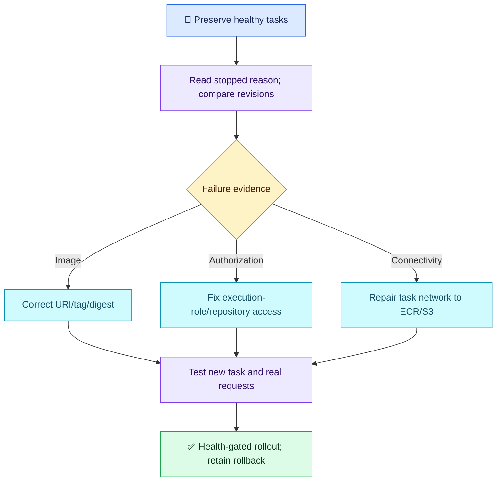

# AWS Q07 — Fargate Cannot Pull an ECR Image

## 🎯 Scenario

After a task-definition image update, new private-subnet Fargate tasks stop with CannotPullContainerError while existing tasks serve traffic. A teammate proposes adding ECR permissions to the application task role and repeatedly retrying. Diagnose and fix the rollout without losing healthy capacity.

## ✅ Interview-ready answer

“I would pause the failing rollout and preserve healthy tasks. I would read stopped-task reasons and service events, compare the old/new task definitions and verify the exact ECR image. Image pulls use the execution role, not the application task role. I would correct only the proven permission, image or connectivity failure, test a new task, and resume deployment with health gates and rollback configured. Old running tasks do not prove that a new image pull can succeed.”

## 🔎 Essential evidence

| Check | Why / action |
| --- | --- |
| Stopped-task reason and service events | Distinguish access denied, missing manifest/tag and connection timeout before changing permissions. Application logs may not exist before startup. |
| Image URI and task-definition revision | Verify account, Region, repository and exact tag/digest exist; check architecture compatibility where indicated. A new tag in the same repository does not normally require new pull permission. |
| Execution role | Inspect executionRoleArn, trust and effective policy. Typical pull actions: ecr:GetAuthorizationToken on `*`; ecr:BatchGetImage, ecr:GetDownloadUrlForLayer and ecr:BatchCheckLayerAvailability scoped to the repository. Check repository policy when relevant, especially cross-account. |
| Task network | Verify task-subnet DNS, HTTPS egress and routing. Use working NAT egress, or for modern Linux Fargate private pulls, ECR api/dkr interface endpoints plus the S3 gateway endpoint for layers. Check endpoint SG ingress 443 from task SG, private DNS, S3 route associations and endpoint policies. |

Illustrative read-only command; replace cluster and stopped task ARN:

```bash
aws ecs describe-tasks --cluster CLUSTER --tasks STOPPED_TASK_ARN
```

Inspect `stoppedReason`, container `reason` and task-definition identity. Existing tasks already pulled their images; they can keep serving even if the same role or network can no longer pull anything. Different roles/images are possibilities, not the only explanations.

**Role boundary:** execution-role permissions support platform operations such as image pulls and configured secret injection. AWS API calls made by application code use its task role; not every configuration fetch belongs to the execution role.

## 🛠️ Safe rollout and proof

Preserve running tasks; stop the faulty deployment or restore the last known-good task-definition revision if appropriate. Reverting an image does not repair a shared network/IAM failure. Use the service's supported deployment strategy with healthy-capacity limits, health checks and rollback alarms/circuit breaker where applicable. Canary/blue-green can help, but neither is universally safest; validate the chosen deployment controller and capacity.

Start a corrected task using the intended execution role/subnets/image. Confirm it pulls the expected digest, stays running, becomes healthy and serves real requests. Check desired/running counts, service steady state, error/latency metrics and no new pull failures before retiring old capacity. Communicate impact and the next update time; give a mitigation estimate only when supported by evidence.



## Evaluation — 2026-10-19

**7.5/10. Interview Acceptance Probability: 70%**, subjective answer-specific coaching, not a hiring prediction. Sixth assessed AWS scenario; Q05 deferred.

**Attempt:** Correctly identified execution role versus task role, proposed checking pull permissions and outbound ECR access, considered different roles/previous images for old tasks, associated new tags with possible permission issues, and proposed rollback, communication and gradual canary/blue-green rollout. Did not specify error inspection, image-existence verification or concrete rollout success gates.

**Credit:** Correct identity selection, relevant network hypothesis, explicit mitigation and protection intent. No penalty for missing CLI syntax or exhaustive permission lists.

**Deductions:** 1 combined missing stopped-task/service-event evidence and exact image existence checks; 0.5 insufficient distinction between new tag and authorization (same-repository tag change normally needs no new grant); 0.5 generic network check without NAT or relevant endpoint path; 0.5 missing test-task/health/request validation before progressing rollout. Rollout absolutes and communication estimates are coaching without extra deductions.

## Recovery comparison

- Earlier permission-identity gaps (AWS Q02/Q06): ✅ correct responsible identity demonstrated here through execution-role selection; original KMS/OAC specifics are not reassessed.
- AWS Q01 missing mitigation: ✅ explicit rollback and gradual rollout proposed in this scenario, with safeguards coached above.
- Repeated diagnostic/verification gaps: 🟡 partially improved — relevant permission/network hypotheses and gradual rollout, but concrete failure evidence and success gates remain missing.
- AWS Q04 network implementation: still unresolved; no concrete route/endpoint checks demonstrated.

## Sources

- [AWS: task execution role](https://docs.aws.amazon.com/AmazonECS/latest/developerguide/task_execution_IAM_role.html)
- [AWS: image-pull errors](https://docs.aws.amazon.com/AmazonECS/latest/developerguide/task_cannot_pull_image.html)
- [AWS: ECR VPC endpoints](https://docs.aws.amazon.com/AmazonECR/latest/userguide/vpc-endpoints.html)
