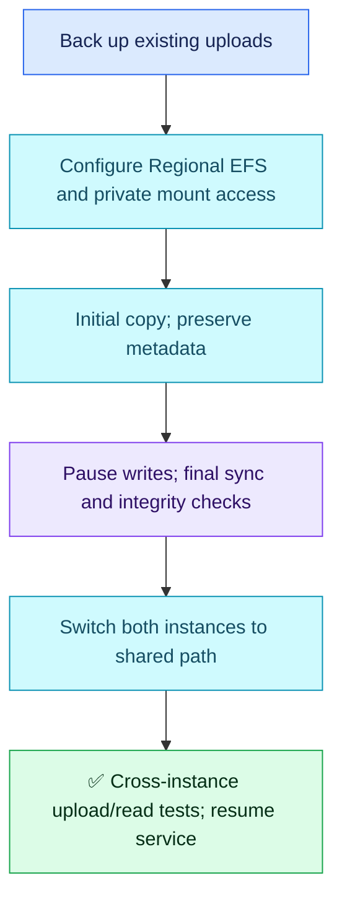

# AWS Q08 — Shared Uploads Across AZs

## Scenario

Two EC2 instances behind an ALB run in different AZs. Uploads exist on an EBS volume attached to one instance, so the other cannot serve them. The application requires a shared filesystem. Choose storage, migrate safely and prove consistent access.

## Interview-ready answer

“I would use EFS Regional, with a mount target in each application's AZ, and mount the same filesystem/path on both instances. EBS cannot attach across AZs. I would back up the source, copy existing files preserving permissions, pause uploads for a final sync and switch both instances to EFS together. I would test uploads through each instance and reads through the other, then verify normal application behavior and retain a safe recovery copy.”

## Configuration and migration

- Use **EFS Regional** for multi-AZ data resilience; EFS One Zone also exists. Allow NFS TCP 2049 to mount targets from the application instance security group, verify DNS/routing, and preserve compatible UID/GID/permissions. Use encrypted transport and appropriate access controls.
- Mount EFS at a temporary destination before copying; do not hide the source files by mounting over the live uploads directory. Confirm application filesystem/locking and performance requirements.
- Make a recoverable, consistent source backup. Perform an initial copy (for example rsync preserving required metadata), then pause/drain writers and perform a final sync. Verify counts/checksums and ownership before directing both applications to the shared path.
- Persist mounts and ensure the app does not silently write to a local directory when the shared mount fails. Resume writes after both instances use the same filesystem.
- Keep the original data for recovery. Once EFS accepts new writes, switching back to the stale EBS copy requires reconciling those writes; it is not a lossless instant rollback.

## Verification

Create a harmless upload through instance A and read it through B; repeat in reverse. Verify existing files, permissions and representative concurrent operations. Use controlled routing or per-instance tests to prove both servers were exercised, then verify real ALB requests, errors and latency. Dashboards supplement these checks but cannot prove file consistency alone.

**Unscored ALB clarification requested by user:** ALB normally selects targets using its configured algorithm (round robin by default), not direct CPU/RAM utilization measurements. Health checks are not filesystem-content checks. EBS Multi-Attach does not remove AZ restrictions or make an ordinary filesystem safe for multiple writers.

## Evaluation — 2026-10-20

**7/10. Interview Acceptance Probability: 65%**, subjective answer-specific coaching, not a hiring prediction. Seventh evaluated AWS attempt; Q05 deferred.

**Attempt:** Correctly rejected cross-AZ EBS attachment, selected EFS for shared access, proposed copying EBS data and connecting both instances to EFS, then watching success rates. Included ALB utilization reasoning, explicitly excluded from scoring at the user's request.

**Credit:** Correct service choice and AZ constraint; migration and monitoring intent. No ALB-related deduction, command-volume penalty or requirement to redesign for object storage.

**Deductions:** 1.5 missing live-write consistency/backup/cutover safeguards (one combined migration gap); 0.75 missing mount-target/private access setup; 0.75 dashboard-only verification without cross-instance file tests. Regional versus One Zone detail is clarification, not an additional penalty.

## Recovery comparison

- Earlier Kubernetes storage misconception: partially improved — explicitly proposes copying data rather than simply switching storage, but safe migration remains unproven.
- AWS Q01–Q04 concrete verification: still unresolved here — success metrics do not establish shared-data correctness. Q06's actual-path test improvement remains historically credited.
- AWS Q04 concrete network access: unresolved for EFS mount access in this answer. Unrelated gaps not reassessed.

## Sources

- [AWS: EFS mount targets](https://docs.aws.amazon.com/efs/latest/ug/accessing-fs.html)
- [AWS: mounting and NFS security](https://docs.aws.amazon.com/efs/latest/ug/mounting-fs-mount-cmd-dns-name.html)
- [AWS: ALB routing algorithms](https://docs.aws.amazon.com/elasticloadbalancing/latest/application/edit-target-group-attributes.html)
