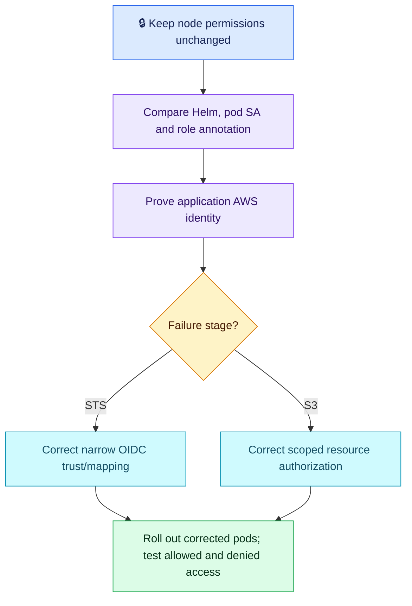

# AWS Q09 — EKS IRSA Access After a Helm Release

## Scenario

New EKS pods run but lose private S3 read access after a Helm release. IRSA previously worked; other applications still access S3. Diagnose the actual AWS identity, restore narrow access and verify isolation without broadening the node role.

## Interview-ready answer

“I would compare the rendered Helm change and actual pods' ServiceAccount with the working revision, inspect its role annotation and prove the identity used by the application. I would distinguish an STS trust failure from an S3 authorization denial, correct the verified mapping/trust or scoped policy in Git, and roll out corrected pods safely. I would test a permitted object read as the workload and confirm unrelated access remains denied, leaving node permissions unchanged.”

## Essential checks

Illustrative read-only checks; replace namespace, pod, container and ServiceAccount. Use the affected app container, not a privileged admin credential context.

```bash
kubectl get pod POD -n NS -o jsonpath='{.spec.serviceAccountName}'
kubectl describe serviceaccount SA -n NS
kubectl exec -n NS POD -c APP -- aws sts get-caller-identity
```

The first two establish intended wiring; the third tests runtime credentials if the CLI is available. If unavailable, use an approved diagnostic through the application's SDK/credential configuration. A separate debug pod or CLI can use different credentials; confirm the app's own provider chain. Do not print JWTs, access keys or secret environment values.

- **Rendered versus live configuration:** compare Helm values/rendered manifests, deployment template and actual affected pods. Check `serviceAccountName` and `eks.amazonaws.com/role-arn`. An omitted service account can select the namespace default; an explicitly nonexistent account normally prevents pod creation, so distinguish these cases.
- **Trust versus permissions:** STS AssumeRoleWithWebIdentity uses the projected OIDC token and preconfigured IAM trust. Verify the cluster issuer/provider, `aud = sts.amazonaws.com` and `sub = system:serviceaccount:NAMESPACE:SERVICEACCOUNT`. Then verify the role's allowed S3 object prefix/actions and relevant bucket-policy denies; include KMS only when the object requires it.
- **Credential overrides:** confirm supported SDK/web-identity configuration and investigate static credentials or custom providers that override IRSA. A correct annotation alone is not proof of the effective role. Temporary credentials refresh through the SDK; trust is not newly created on each request.
- **Fix and verify:** correct the chart/trust/policy source, preserve narrow scope and recreate affected pods when needed for injection changes. Test an actual permitted read through the application, confirm expected role and no access to unrelated objects. Monitor AccessDenied and application success after rollout. Pipeline gates prevent this only if they validate the relevant rendered identity settings.

Node credentials can be exposed to pods that can access IMDS; broad node permissions create shared risk but are not automatically inherited by every correctly isolated workload.



## Evaluation — 2026-10-20

**7.5/10. Interview Acceptance Probability: 70%**, subjective answer-specific coaching, not hiring probability. Eighth AWS assessment; Q05 deferred.

**Attempt:** Rejected broad node permissions; explained OIDC, ServiceAccount-role mapping and temporary credentials; proposed inspecting deployment SA, annotation, AWS role permissions and Helm values mistakes. Advocated CI validation. No explicit runtime caller-identity test, specific trust-condition check or post-fix access test.

**Credit:** Strong configuration diagnosis, relevant Kubernetes/AWS split, correct temporary-credential direction and least-privilege intent. Deployment inspection is valid; actual-pod checks add precision. No penalty for omitted exact command syntax or repeated pipeline discussion.

**Deductions:** 1 missing actual runtime identity/credential-chain proof; 0.75 missing concrete issuer/sub/aud trust verification and distinction from S3 permission denial; 0.75 missing controlled rollout and actual allowed/denied access verification. Node-role inheritance wording is coaching, not an extra deduction.

## Recovery comparison

- Kubernetes Q06 / AWS Q07 identity mapping: strong conceptual understanding reinforced; Helm/ServiceAccount diagnosis remains sound.
- AWS Q02 effective-identity proof: still unresolved — configured role inspected, actual caller not demonstrated.
- AWS Q06 policy specificity: partially improved — role and SA named, exact trust/scope checks remain incomplete.
- Repeated recovery verification: still unresolved in this answer; preserve historical Q06 improvement without treating it as universal mastery.

## Sources

- [AWS: assign IAM roles to service accounts](https://docs.aws.amazon.com/eks/latest/userguide/associate-service-account-role.html)
- [AWS: IRSA SDK credential chain](https://docs.aws.amazon.com/eks/latest/userguide/iam-roles-for-service-accounts-minimum-sdk.html)
- [AWS: IRSA troubleshooting](https://repost.aws/knowledge-center/eks-pods-iam-role-service-accounts)
