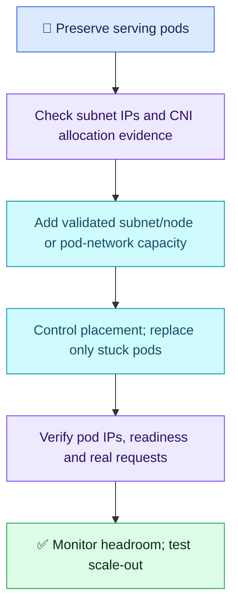

# AWS Q10 — EKS Subnet IP Exhaustion

## Scenario

Replicas increase from 6 to 18. New pods are assigned to nodes but remain ContainerCreating with FailedCreatePodSandBox/IP-allocation errors. CPU/memory are available; the worker subnet has almost no free IPv4 addresses. Diagnose, recover without disrupting healthy workloads and prevent recurrence.

## Interview-ready answer

“I would preserve healthy pods and confirm subnet address exhaustion using EC2 subnet capacity and VPC CNI evidence. Pod scheduling limits are not a count of free IPs. I would provision correctly routed new subnet/node capacity or a supported alternate pod-subnet design, validate it, then selectively recreate stuck pods on that capacity. Prefix delegation can improve node density but needs free contiguous addresses. I would verify pod IPs, readiness and real requests, and monitor subnet headroom before future scale-outs.”

## Essential checks

Illustrative read-only commands; replace namespace, subnet IDs and the aws-node pod on an affected node. Never expose credentials in collected diagnostics.

```bash
kubectl describe pod POD -n NS
aws ec2 describe-subnets --subnet-ids SUBNET_ID --query 'Subnets[].{Subnet:SubnetId,FreeIPs:AvailableIpAddressCount}'
kubectl logs -n kube-system AWS_NODE_POD -c aws-node --tail=100
```

Events identify allocation failure; EC2 reports subnet headroom; aws-node/ipamd evidence helps distinguish subnet shortage from ENI limits, IAM/API failures or prefix fragmentation. Consult node-local ipamd logs if the error is not in container stdout. `allocatable.pods - running pods` measures neither subnet free IPs nor CNI warm-pool availability; some pods use host networking, and CNI can reserve unused IPs.

## Safe recovery and prevention

- Do not restart healthy pods or blindly add nodes in the exhausted subnet; new nodes also consume addresses. Preserve existing serving capacity while preparing recovery.
- Existing subnet CIDRs cannot be enlarged in place. Use available non-overlapping VPC space, or associate a suitable secondary VPC CIDR and create new subnets. Configure routes, security, DNS and service access; create a new node group in the chosen subnets when appropriate. Custom networking with ENIConfig is another planned option for separate pod subnets.
- Verify new nodes/CNI are ready. Pods already bound to old nodes do not automatically move when capacity appears. Control placement (for example cordon affected nodes without evicting healthy pods), selectively replace stuck controller-managed pods and validate before any gradual draining under disruption budgets. Avoid a blanket restart or uncontrolled rescheduling back to exhausted nodes.
- Prefix delegation assigns IPv4 /28 blocks from subnet space; it requires contiguous free blocks and compatible node/CNI configuration. It improves density/allocation efficiency, not the subnet's total address count. Plan warm-pool targets, rollout surge and failure headroom; test configuration on new capacity rather than treating a global switch as risk-free.
- Calico for network policy alongside VPC CNI leaves VPC CNI in charge of addresses. Calico as the networking/IPAM replacement is a different architecture and migration, not a quick incident fix. VPC CNI is not inherently inefficient; choose networking based on requirements.
- HPA changes replica count; VPA changes pod resource requests, not replicas. Node autoscaling is separate. The scheduler assigns pods to nodes; controllers create replicas and node-side components establish networking.
- Verify new pod IPs, Ready status, desired available replicas and real application requests, plus errors/latency and subnet/CNI headroom. Test representative scale-out and alert on low free addresses, allocation failures and prolonged startup. A green dashboard alone does not prove recovery.



## Evaluation — 2026-10-20

**6.5/10. Interview Acceptance Probability: 60%**, subjective answer-specific coaching, not hiring probability. Ninth assessed AWS attempt; Q05 deferred.

**Attempt:** Rejected mass restarts and more nodes in exhausted subnets; identified IP shortage. Proposed subtracting active pods from allocatable pod count to calculate free IPs, wider new subnets/node capacity, prefix delegation and VPC CNI with Calico for a separate range. Said HPA/VPA both scale replicas. Proposed preserving old workloads and watching new pods become healthy in dashboards.

**Credit:** Correct root constraint, rejection of destructive actions, explicit parallel-capacity design and availability awareness. New-subnet proposal is credited, not treated as a proposal to resize an existing subnet in place. No penalty for omitted exact CLI syntax or advanced configuration detail.

**Deductions:** 1 invalid free-IP calculation; 1 Calico policy integration confused with replacement IPAM; 0.5 missing prefix-delegation free/contiguous-space limits; 0.5 VPA replica-scaling misconception; 0.5 combined incomplete placement of already-bound stuck pods and concrete end-to-end validation. No duplicate deductions for the same capacity gap.

## Recovery comparison

- Prior safe-mitigation gaps: improved — explicitly preserves healthy workloads and adds parallel capacity.
- AWS Q04 concrete network/capacity evidence: partially improved — new subnets identified, but measurement and network-mode distinctions incorrect.
- Repeated recovery verification: partially improved through pod health, but real requests and IP-headroom proof remain absent.
- Other IAM/storage/DR gaps not reassessed. Kubernetes cross-reference adds no separate score.

## Sources

- [AWS: optimizing EKS IP usage](https://docs.aws.amazon.com/eks/latest/best-practices/ip-opt.html)
- [AWS: prefix mode](https://docs.aws.amazon.com/eks/latest/best-practices/prefix-mode-linux.html)
- [AWS: custom networking](https://docs.aws.amazon.com/eks/latest/best-practices/custom-networking.html)
- [Calico: EKS policy versus networking options](https://docs.tigera.io/calico/latest/getting-started/kubernetes/managed-public-cloud/eks)
