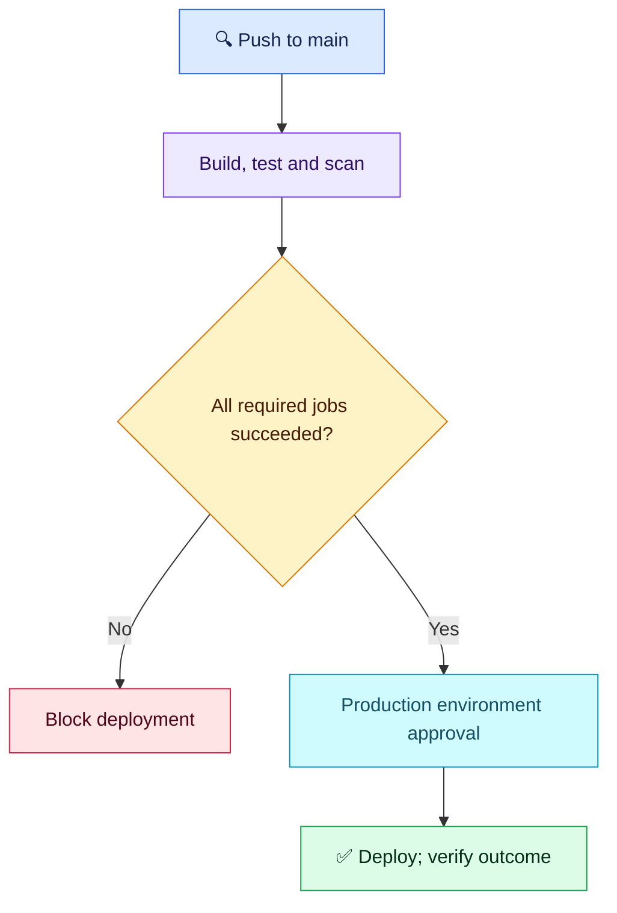

# Q01 — Deployment bypasses failed checks

**Scenario:** Push-to-main workflow has build/test/scan/deploy jobs; deploy needs only build. Build succeeds, test fails, scan still runs, production deploy starts. Teammate proposes approval as the only fix. Diagnose, gate and verify failures/skips cannot bypass checks.

## Evaluation — 2026-10-25

**8.5/10; acceptance estimate 80%** (subjective, answer-specific).

**Attempt:** Correctly identified dependency wiring; required successful build/test/scan; proposed needs and success conditions at job/step level; production environment reviewers and scoped configuration/secrets; run graph for verification. Said build/test can be wired similarly if required and lower-environment approvals usually unnecessary.

**Credit:** Central diagnosis and safe gating intent correct; environment approvals complement machine checks. Four-year baseline: no requirement for a complete workflow or obscure flags.
**Deductions:** deployment's complete dependency set/default success behavior not made precise (0.5); graph inspection without deliberate failed/skipped/all-success tests (1). Saying need rather than needs is a minor naming slip, not an extra deduction. Lower-environment approval is risk-dependent, not categorically wrong; no separate penalty.

## Compact answer

> Deploy starts because only build is its prerequisite. Make all mandatory jobs dependencies, preserving their failure exit status. Ordinary needs behavior blocks deploy when a dependency fails or is skipped; success() alone does not wait for unrelated jobs. Reference the protected production environment on deploy and configure required reviewers there. Approval is an additional gate, not a replacement for automated checks. Test failure, skip and all-success paths in a safe environment; verify deploy never starts for failed/skipped prerequisites and waits for approval after all pass.

**Focused excerpt** — existing build/test/scan job IDs and deployment script assumed:

```yaml
jobs:
  deploy:
    needs: [build, test, scan]
    runs-on: ubuntu-latest
    environment: production
    steps:
      - run: ./deploy.sh
```

No explicit `if: success()` needed here; default success gating applies. Configure reviewers in repository environment settings (feature availability depends on plan/visibility). Review conditions such as always(), continue-on-error and commands that mask failures; do not turn mandatory checks into best-effort steps. Job order in YAML is not dependency order. Lower-environment approvals depend on risk/policy; they are often automated.

| Verification | Expected |
| --- | --- |
| Fail build, test or scan separately | Deploy does not start |
| Skip a required job | Deploy does not start |
| All pass, approval withheld/rejected | No production execution |
| All pass, approval granted | Deploy starts once gates pass |

Use the graph plus job results/logs and deployment records, with a harmless deployment stub for negative tests; no real production experiments needed.



**Takeaway:** Approval authorizes an eligible release; dependencies establish eligibility. Graph inspection is useful, but negative-path tests prove the protection. Sources: [Jobs and dependencies](https://docs.github.com/en/actions/how-tos/write-workflows/choose-what-workflows-do/use-jobs), [Environments](https://docs.github.com/en/actions/reference/workflows-and-actions/deployments-and-environments).
