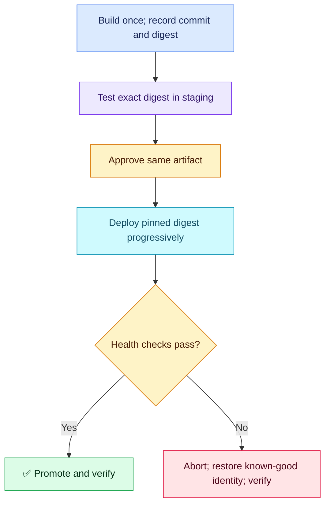

# Q02 — Promote the exact tested artifact

**Scenario:** Commit A image tagged latest passes staging; B overwrites latest before approval. Production deploys different content. Teammate proposes rebuilding A. Prove identity, promote the tested image and retain reliable rollback.

## Evaluation — 2026-10-25

**6.5/10; acceptance estimate 60%** (subjective, answer-specific).

**Attempt:** Opening says accept rebuild but immediately calls it redundant; interpret as rejection, without a wording penalty. Proposed lower-environment validation, separate branches/pipelines/environments, approvals, semantic versions and production ECR; described progressive delivery, metrics and fallback. Attributed Git watching to Argo Rollouts. Did not demonstrate tested-versus-running digest comparison or immutable artifact handoff.

**Credit:** Same-image promotion intent, avoiding latest, release naming, controlled rollout/rollback and useful error/latency signals.
**Deductions:** missing immutable content identity and traceable build-once promotion (1.5 combined); Argo CD/Rollouts responsibilities confused (1); rollback identity/compatibility and recovery not established (0.75); PR-open production trigger not distinguished from an approved trusted revision (0.25). No extra deduction for pipeline structure preference, command count or speech slips.

## Compact answer

> Compare the digest recorded for A's tested image with the deployed image identity. Build once, record commit/run/digest and test that digest in staging. Promote the exact digest through approval instead of rebuilding or resolving a moving tag. Use immutable release tags for readable labels and pin the deployment to its digest. Keep the prior working digest and compatible configuration available. GitOps sync applies the approved manifest; Argo Rollouts manages progressive traffic/promotion and analysis. Abort on defined error/latency thresholds, verify service recovery, and update Git to the intended stable version for lasting rollback.

**Identity example:** `registry.example.com/app@sha256:<approved-digest>` (placeholder). A semantic version tag can still be overwritten unless immutability is enforced. A separate registry/repository alone does not solve that; if copying images, verify the destination preserves the approved content/digest. Rebuilding the same commit can change base-image/dependency contents.

**Useful read-only checks** (substitute actual repo, tag and pod):

```bash
aws ecr describe-images --repository-name <repo> --image-ids imageTag=<release-tag> --query 'imageDetails[0].imageDigest'
kubectl get pod <pod> -n <ns> -o jsonpath='{.status.containerStatuses[*].imageID}'
```

Compare against recorded staging/test evidence, not today's latest tag. For multi-platform images, distinguish index digest from runtime platform-manifest digest and verify that relationship; raw strings need not be identical. Track tested configuration as well as image identity.

- **Argo CD:** reconciles Git manifests with the cluster (or another GitOps tool can fill this role).
- **Argo Rollouts:** watches Rollout resources; manages canary/blue-green, analysis and promotion. It does not itself poll Git/Helm values for updates.
- PR opening may trigger validation; production release must be bound to the approved trusted revision and artifact. Separate workflows are optional, not proof of artifact identity.
- Prometheus analysis needs explicit error/latency thresholds, a representative traffic/window and a defined failure action. Merely mentioning metrics does not prove recovery. Rollback is not guaranteed instant or safe after incompatible schema/data changes.



**Recovery:** Policy/approval intent remains strong. Concrete error/latency signals improve observability discussion; thresholds and observed recovery remain unproven. Artifact identity is a new priority gap.

Sources: [ECR immutable tags](https://docs.aws.amazon.com/AmazonECR/latest/userguide/image-tag-mutability.html), [Argo Rollouts FAQ](https://argoproj.github.io/argo-rollouts/FAQ/).
