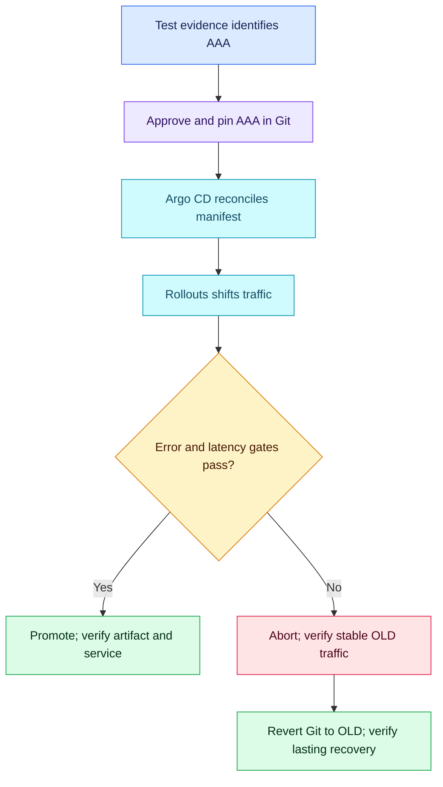

# Q02.1 - Tested artifact promotion: coached retry

## Scenario

Staging tested v2.4.0 at sha256:AAA from commit A. The tag now resolves to BBB; AAA still exists. Production uses Argo CD and Argo Rollouts; OLD is the previous stable digest. Explain artifact selection, approval evidence, controller roles and failure recovery. All digests are illustrative placeholders.

## Attempt - 2026-10-26

Candidate rejected tag/approval alone, proposed digest or commit ID, correctly assigned Git manifest reconciliation to Argo CD and release promotion/abort/undo to Rollouts, recognized neither automatically updates Git, and selected abort/undo for a faulty release. Did not explicitly select existing AAA rather than rebuild A, bind approval/test evidence to the deployment digest, or verify restored traffic and application health. A commit ID used as an image tag is not equivalent to a content digest. Git reconciliation concern is valid for live spec changes; an abort alone does not automatically create an endless redeploy loop.

**Verdict: partially improved; 7/10, 65% subjective answer-specific acceptance estimate, not hiring probability.** Coached retry; preserve Q02's 6.5/10. Deductions: 1 for treating commit-ID tagging as interchangeable with digest identity and not explicitly selecting existing AAA; 1 for missing approval-to-manifest-to-running identity checks; 1 for missing observable rollback verification. No deduction for spelling, lack of exact commands, semantic-version labels, or not listing optional tools.

| Earlier gap | Retry evidence | Status |
| --- | --- | --- |
| Artifact identity | Digest proposed, but commit tag treated as equivalent; AAA and handoff evidence omitted | Partially improved |
| Controller roles | CD reconciles Git; Rollouts promotes/aborts | Resolved in this coached attempt; independent retest still needed |
| Lasting rollback | Git alignment and abort/undo identified; exact OLD and verification omitted | Partially improved |
| Recovery signals | No before/after health or traffic criteria supplied | Still unresolved |

## Compact corrected answer

> Deploy the existing tested image at `registry.example.com/app@sha256:AAA`, not BBB or a fresh rebuild of A. Keep semantic version and commit as readable provenance, but bind approval to the tested digest, build/test run and reviewed production manifest. Verify the applied image and running image identity match that approved artifact. Argo CD reconciles Git configuration; Argo Rollouts manages progressive delivery and promotion/abort. On excessive errors, abort the rollout to return traffic to the stable version, verify OLD serves requests with recovered errors/latency and healthy replicas, then set Git to OLD for lasting rollback and reconcile. An undo changes the live desired template and must be coordinated with GitOps.

Digest pinning identifies content; a commit-derived tag can still be moved, and rebuilding a commit can resolve different dependencies. For multi-platform images, distinguish the pinned index digest from the platform manifest identity reported by the runtime and verify their relationship rather than assuming literal equality.

Aborting a rollout can keep the failed desired template while serving the stable ReplicaSet; it does not necessarily cause repeated deployment through Argo CD. A lasting revert updates the Git desired template. Recovery requires measured service health, not merely a successful abort command.

No deployment commands executed. Q03 remains pending; this retry does not add a main-numbered question or independently prove mastery.

Sources: [Docker digest pinning](https://docs.docker.com/reference/cli/docker/image/pull/), [Argo Rollouts rollback and GitOps behavior](https://argoproj.github.io/argo-rollouts/FAQ/).
