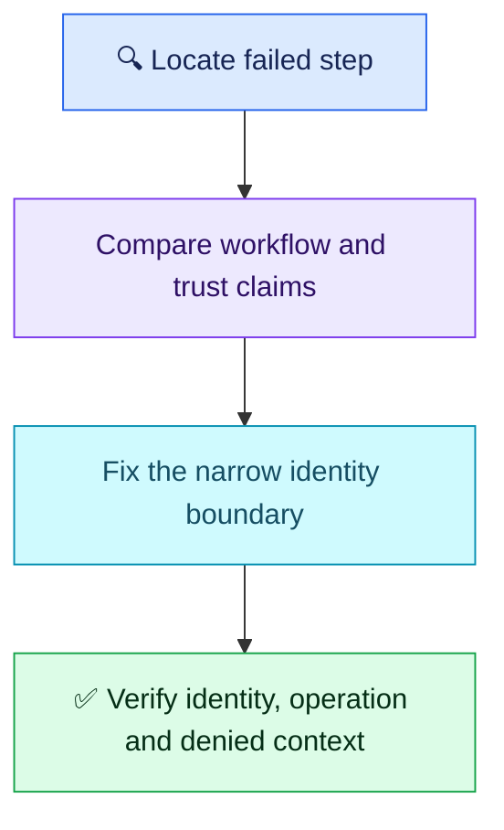

# Q03 — OIDC deployment identity

## Scenario

A production GitHub Actions job moves from stored AWS keys to OIDC. Assuming the deployment role returns AccessDenied; the job uses environment `production`. A teammate suggests administrator keys or trusting every repository. Diagnose, restrict access and verify safely.

## Evaluation — 2026-10-26

**8.5/10; Interview Acceptance Probability: 80%** (subjective coaching estimate, not hiring probability).

- ✅ Correct: rejects broad/static credentials; scopes organization, repository and production; checks CloudTrail, role ARN, permissions and `id-token: write`.
- **−0.75:** trust-versus-resource permission boundary needs precision; audience/provider checks and exact subject matching were not demonstrated. Environment scoping was explicitly credited.
- **−0.75:** retry plus CloudTrail is useful, but does not prove intended runtime identity, required operation access or rejection of an unauthorized context.
- Wording clarification, no additional deduction: GitHub issues the OIDC JWT; AWS STS exchanges it for temporary AWS credentials. No command-count or syntax penalty.

Attempt evidence: user said “particular repository from a particular organization”, “production environment should also be mentioned”, “ID token write is enabled”, and proposed checking CloudTrail before and after retrying. They did not propose broadening trust.

## Compact interview answer

First identify whether token acquisition, role assumption or the subsequent AWS operation failed. Inspect the workflow error and matching CloudTrail `AssumeRoleWithWebIdentity` event. For assumption failure, verify the role ARN, GitHub OIDC provider and role trust policy; adding S3/ECR permissions cannot fix a mismatched trust condition. Once assumption works, check only the resource permissions needed by deployment.

### Essential configuration checks

- Job: `environment: production` and `permissions: {id-token: write}`; add `contents: read` when checkout needs it. Token permission itself grants no AWS resource access.
- Trust: GitHub federated provider, action `sts:AssumeRoleWithWebIdentity`, expected audience and exact subject. Protect the GitHub environment with allowed deployment branches/tags and approvals.

Illustrative **trust-policy condition excerpt**, not a complete policy; replace ORG/REPO with the actual identity:

```json
"Condition": {
  "StringEquals": {
    "token.actions.githubusercontent.com:aud": "sts.amazonaws.com",
    "token.actions.githubusercontent.com:sub": "repo:ORG/REPO:environment:production"
  }
}
```

Match the repository's actual subject format: newer/opted-in repositories may include immutable owner/repository IDs. Do not assume the branch subject applies when the job uses an environment. Never print bearer tokens or credentials into logs.

### Verify before deployment

```bash
aws sts get-caller-identity
```

Confirms the expected account and assumed role. Then perform a harmless required read against the intended resource; successful authentication alone does not prove deployment authorization. Use controlled non-deploying tests to confirm a wrong repository/environment is denied; an unapproved branch should be blocked by environment rules. Correlate the run with CloudTrail. Keep production writes gated.



**Takeaway:** trust controls who may assume the role; resource policies/permissions control what that session may do. CloudTrail supports investigation, while controlled operation tests prove access boundaries.

Sources: [GitHub OIDC in AWS](https://docs.github.com/en/actions/how-tos/secure-your-work/security-harden-deployments/oidc-in-aws), [AWS STS API](https://docs.aws.amazon.com/STS/latest/APIReference/API_AssumeRoleWithWebIdentity.html), [CloudTrail IAM/STS logging](https://docs.aws.amazon.com/IAM/latest/UserGuide/cloudtrail-integration.html).
