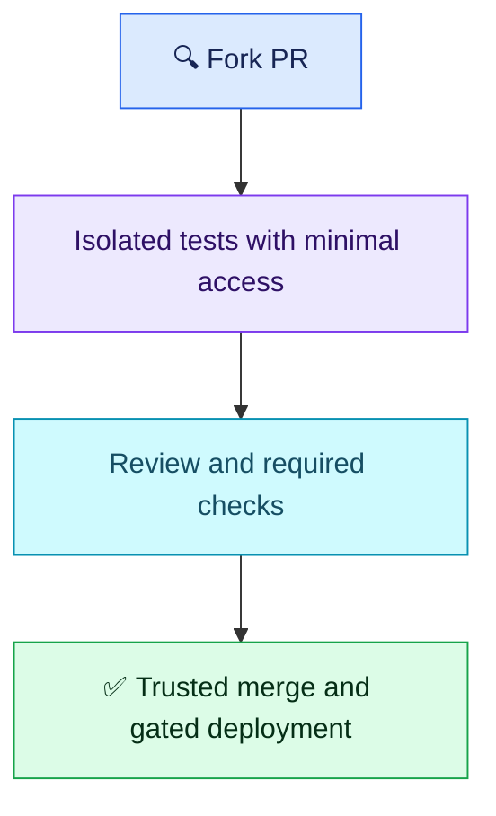

# Q04 — Untrusted pull requests and runner isolation

## Scenario

A public repository receives fork PRs. A teammate proposes pull_request_target, explicitly checking out contributor code, and testing it on the production self-hosted runner with internal network access. Assess the risks and design safe checks and deployment.

## Evaluation — 2026-10-26

**8/10; Interview Acceptance Probability 75%** (subjective coaching estimate, not hiring probability).

- Correct: rejects privileged execution of untrusted code and production runner reuse; proposes limited-permission pull_request tests, scans/review and post-merge deployment.
- **−0.5 mechanism:** trusted base workflow/checkout alone does not give a contributor execution access. In this scenario, explicitly checking out and running their code inside that privileged context creates the exposure.
- **−1 isolation:** a separate pipeline is useful but does not establish an isolated execution boundary. Specify disposable runner, no production/internal network access, no production secrets and no deployment credentials.
- **−0.5 trigger safety:** closed also includes rejected PRs; require merged == true and intended base branch, or use push to protected main. Credit user's explicit intent to deploy only after merge.

Attempt evidence: user rejected the shared runner, proposed “pull request with limited privileges”, then an internal pipeline on “pull request close” after scans and approvals. No deduction for brevity or omitted YAML. Claimed interview rarity does not change technical scoring; do not infer frequency for target employers.

## Compact answer

Run fork tests with pull_request and minimal read permissions on a clean GitHub-hosted runner, or a disposable isolated self-hosted runner without production connectivity or credentials. Use test services and synthetic data for integration checks. Separate workflows alone are insufficient if execution still shares privileged infrastructure.

pull_request_target uses trusted base workflow context and can have secrets/write permissions; it does not execute fork code by default. Never introduce untrusted executable code into that privileged context. It can serve trusted metadata operations such as labeling when safely implemented.

For deployment, require reviewed merge into protected main, a trusted deployment runner and protected production environment with narrowly scoped OIDC. On a closed event, additionally require a merged PR targeting the intended branch; closing alone is not approval. Keep production artifact promotion tied to the verified immutable image.

Minimal PR-workflow excerpt, not a complete workflow:

```yaml
on: pull_request
permissions:
  contents: read
jobs:
  test:
    runs-on: ubuntu-latest
    # Checkout and tests here; no production secrets or private network attachment.
```

Verify with a controlled fork PR: checks run, production credentials/network are inaccessible, and no deployment runs. Closing without merging must not deploy. Reviewed merge follows the intended protected deployment path. Do not test by exposing real secrets.



**Takeaway:** the key boundary is what untrusted code can reach, not how many workflow files exist. Review/scan approval does not sanitize a persistent runner.

Sources: [GitHub trigger security](https://docs.github.com/en/actions/reference/security/securely-using-pull_request_target), [runner risks](https://docs.github.com/en/organizations/managing-organization-settings/disabling-or-limiting-github-actions-for-your-organization), [workflow events](https://docs.github.com/en/actions/reference/workflows-and-actions/events-that-trigger-workflows).
