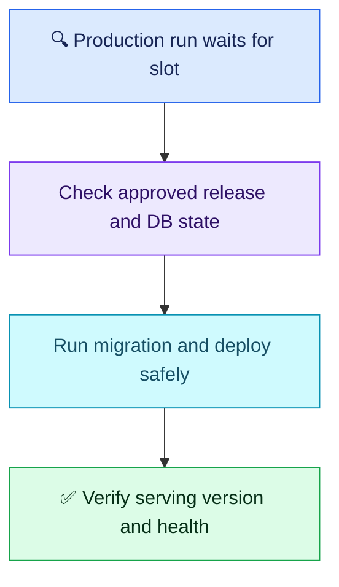

# Q05 — Overlapping production deployments

## Scenario

Two runs of the same workflow deploy to production. Older A finishes after newer B and overwrites it. A teammate proposes canceling all older runs, including active database migrations. Prevent overlap/stale releases, decide safe cancellation and verify the serving version.

## Evaluation — 2026-10-26

**8/10; Interview Acceptance Probability: 75%** (subjective coaching estimate, not hiring probability).

- ✅ Correct: identifies the race, uses the same concurrency group, knows cancel-in-progress defaults to false and protects an active migration. For A already running and only B waiting, the proposed serialization is correct.
- **−0.5:** serialization alone does not prevent a stale rerun or guarantee release-version ordering. No stale-release check demonstrated.
- **−0.5:** A failing releases the concurrency slot, but B must not blindly continue after a partially failed migration; inspect database migration state and compatibility first.
- **−1:** no check of actual running version/digest or application health, although explicitly requested.

Attempt evidence: user proposed the same group under concurrency, omitted cancel-in-progress because false is default, and said B waits until A finishes “either being successful or being failure”. No penalty for missing YAML, advanced queue syntax or concise explanation.

## Compact answer

Serialize production-changing jobs using a stable group for this application/environment. Keep the migration and deployment within that protected execution period; await completion rather than launching detached work and releasing the slot early. Do not cancel a live migration merely because a newer release exists. If it fails, inspect its recorded state before permitting another deployment.

Illustrative concurrency excerpt:

```yaml
concurrency:
  group: myapp-production
  cancel-in-progress: false
```

This protects the active run from concurrency-triggered cancellation, not manual cancellation, timeout or runner loss. Default queue behavior retains only one pending run; another arrival replaces that pending run. Current GitHub.com supports queue: max for multiple pending runs, but queue arrival order is not release-version order. No deduction for omitting this optional feature.

Before changing production, check that the candidate digest/release is still approved for this environment and has not been superseded. Reject stale reruns unless an explicit compatible rollback is authorized. Pure build/test jobs can often be canceled safely; state-changing work needs recovery-aware handling.

**Verify:** compare deployed workload image digest and application version with the approved release, confirm rollout completion and migration status, then check smoke tests, error rate and latency. A green workflow alone does not prove what users are receiving. Exercise overlapping A/B and failed-migration cases safely in a test environment.



**Takeaway:** mutual exclusion, release freshness and successful recovery are separate checks. Do not equate a free concurrency slot with a healthy database.

Source: [GitHub concurrency behavior](https://docs.github.com/en/actions/how-tos/write-workflows/choose-when-workflows-run/control-workflow-concurrency), verified 2026-10-26.
