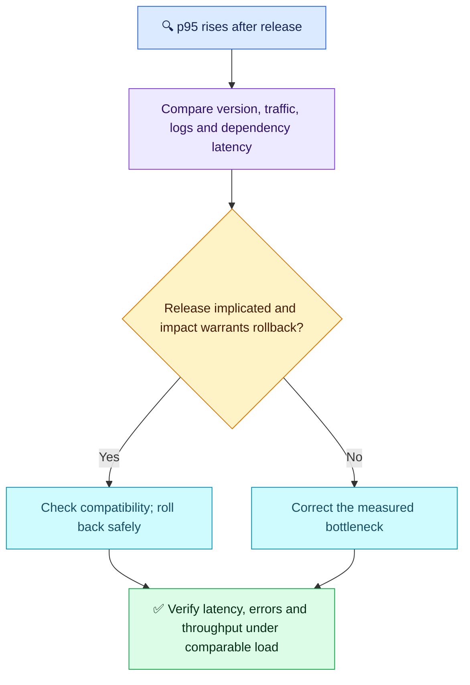

# Q11 — Latency after a release

## Scenario

After a release, API p95 rises from 200 ms to 2 seconds. All pods are Ready, average CPU is 40%, and 5xx rates are unchanged. Prometheus/Grafana and centralized application logs are available. Isolate the bottleneck, decide whether to roll back, and prove recovery.

## Evaluation — 2026-10-20

**Score: 5.5/10. Interview Acceptance Probability: 45%** — subjective coaching estimate for this answer, not a hiring probability. Follow-up 1 of 5; original scores preserved.

**Attempt summary:** Started with dashboards and workload localization; proposed HPA/VPA, external DB checks using dig/traceroute, probes, kube-proxy, scheduler, placement constraints and IP exhaustion. Proposed logs/events and checking reduced p95 after fixes. Defined p95 as an average and split HPA/VPA by stateless/stateful workloads. Did not describe a rollback decision.

**Credit:** Workload-level localization, external-dependency hypothesis, logs/events and a customer-latency recovery signal. No demand for irrelevant commands or staff-level breadth.

**Material deductions:** Incorrect metric/scaling concepts (1.5); insufficient evidence-led isolation despite the supplied Ready/CPU/release facts (1.5); missing rollback decision (1); recovery criteria lack representative traffic and sustained confirmation (0.5). Ancillary corrections below are coaching, not additional deductions.

## Compact interview answer

> p95 is the duration within which 95% of observed requests finish, not their average. I would compare before/after release latency by endpoint and version alongside request rate, errors and saturation. Ready pods and 40% average CPU do not exclude slow code, CPU throttling, request queues or database waits. I would correlate slow-request logs with dependency timings to locate the delay. If the release is strongly implicated and user impact continues, I would roll back through the approved deployment/GitOps path after checking schema/configuration compatibility. Otherwise I would fix the measured bottleneck. Recovery means p95 returns near the 200 ms baseline or agreed SLO under comparable traffic, without increased errors, reduced throughput or new dependency saturation, sustained over an observation window.

## Useful evidence and commands

Placeholders represent the affected namespace, deployment and container. Read-only examples:

```bash
kubectl logs deployment/<deployment> -n <namespace> -c <container> --since=15m --timestamps
kubectl describe deployment <deployment> -n <namespace>
```

- **Logs:** sample recent requests; use centralized logs across replicas to compare slow endpoints, durations, request IDs and DB timeouts with the release timestamp. DNS resolution alone does not measure query execution or connection-pool waits.
- **Deployment:** confirm the running revision, replica state and recent rollout events. Investigate scheduling/probes only if evidence points there.
- **Dashboard:** compare per-version/endpoint latency and traffic, per-container CPU/throttling, memory/GC, queues and DB pool/query latency. Low averaged CPU can hide individual bottlenecks. Traces help if already instrumented; they are not assumed available.

## Corrections to retain

| Claim | Correct distinction |
| --- | --- |
| HPA stateless; VPA stateful | HPA changes replicas; VPA adjusts container resource requests (and limits according to policy). Both can apply to Deployment/StatefulSet workloads; application safety still matters. |
| Probe grace period controls readiness | Startup/initial delay, period, timeout and failure threshold differ. Liveness failure restarts a container; readiness controls normal Service traffic eligibility. Ready is not a latency guarantee. |
| Scale scheduler replicas to fix this | No scheduling failure is shown. EKS manages its control-plane scheduler; customer kube-system pod scaling is not the remedy. |
| kube-proxy uses IPv4 tables | iptables/IPVS are possible Service implementations; IPv4 is an address family. Endpoint/network investigation needs evidence. |
| StatefulSets are only for special environments | Production usage varies; managed RDS is an architecture choice, not a rule about StatefulSets. |

## Visual reasoning



## Weakness recovery

| Previous gap | Q11 evidence | Result |
| --- | --- | --- |
| Q01/Q02/Q08: measurable recovery | Explicitly checks reduced p95; no comparable-load/window criteria | Partially improved |
| Q08: prove cause before scaling | Lists many components without using the release/Ready/CPU evidence to narrow them | Unresolved |
| AWS Q10: HPA/VPA distinction | Repeats stateless/stateful split and replica confusion | Unresolved; no duplicate AWS score |
| Q01/Q09: safe mitigation decision | No rollback criteria despite the question | Unresolved |
| Storage, identity and PDB gaps | Not tested here | Not reassessed |

**Takeaway:** Follow evidence from the failing request path; component familiarity alone does not isolate a performance regression. Full five-question readiness review follows Q15.

Sources: [Prometheus percentiles](https://prometheus.io/docs/practices/histograms/), [Kubernetes HPA](https://kubernetes.io/docs/concepts/workloads/autoscaling/horizontal-pod-autoscale/), [Kubernetes VPA](https://kubernetes.io/docs/concepts/workloads/autoscaling/vertical-pod-autoscale/).
