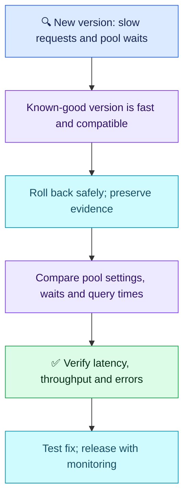

# Q11.1 — Latency retry after coaching

## Scenario

After a release, EKS API p95 rises from 200 ms to 2 seconds. All six pods are Ready, none restart or remain Pending, CPU averages 40%, and traffic/5xx rates are unchanged. Logs show longer database connection-pool waits in the new version; the previous version remains fast under comparable traffic and is schema-compatible. A teammate proposes VPA to add replicas. Explain p95, investigation, scaling, rollback and recovery.

## Evaluation — 2026-10-20

**6.5/10; answer-specific acceptance estimate 55%** (subjective coaching estimate, not hiring probability). Coached retry after Q11 feedback, not independent mastery evidence. Original Q11 remains 5.5/10. This extra attempt does not consume Q12–Q15 or replace first-attempt averages.

**Attempt summary:** Defined the percentile boundary but applied it to workloads/pods. Correctly described HPA replica scaling and VPA resource changes for both workload types, then ambiguously said VPA could do that too. Recommended HPA for this incident. Chose rollback first, followed by investigation and later rollout. Mentioned logs, events, DB latency and a p95 dashboard; recommended canary/blue-green and rejected rolling updates generally.

**Credit:** Clear rollback-first mitigation with a known-good version; corrected most autoscaler terminology; retained application-latency verification and dependency awareness. No deduction for optional commands or minor speech/syntax slips.

**Material deductions (3.5 total):** percentile population still wrong (0.5); HPA chosen without capacity evidence and central connection-pool clue not investigated specifically (1.5 combined); recovery lacks baseline/comparable traffic/sustained checks (1); blanket rejection of rolling updates (0.5). Ambiguous VPA wording is clarified, not separately penalized.

## Compact answer

> p95 of 2 seconds means approximately 95% of measured requests finish within 2 seconds, not 95% of pods. The new version's increased connection-pool wait points to an application/pool regression. I would roll back through the approved release path because the old version is fast and schema-compatible, preserving logs and metrics. Then I would compare pool settings, active/idle/waiting connections and query durations between versions, checking for connections held too long or not returned. HPA changes replicas; VPA changes container resources, not replica count. Neither is automatically the fix: extra replicas can create more DB connections and worsen pressure. I would verify p95 near 200 ms or the agreed SLO, reduced pool waits, normal throughput and no extra errors under comparable traffic over a sustained window, then test and gradually release the correction.

## Essential evidence

```bash
kubectl logs <pod-name> -n <namespace> --since=15m --timestamps
```

Use slow-request timestamps/IDs to correlate pool waits with the release and DB metrics; compare versions in centralized logs. Pool-acquisition wait is distinct from DNS/network time and query execution. A slow query can hold connections longer, but a pool regression is not proof the DB server itself is slow. Pod events are useful for lifecycle failures, not the primary evidence here.

**Deployment choice:** Canary and blue-green can help control exposure. RollingUpdate is also valid with suitable readiness, surge/unavailability settings, compatible versions and monitoring. Recreate normally interrupts service; choose based on actual availability and compatibility requirements rather than a universal ban.

## Recovery comparison

| Q11 gap | Q11.1 result |
| --- | --- |
| Missing rollback decision | Resolved in this coached attempt: explicit rollback first; confirm independently later |
| p95 as an average | Partially improved: percentile boundary understood, but requests confused with pods |
| HPA/VPA distinction | Partially improved: core roles corrected; VPA does not add/remove replicas and HPA is not justified by this evidence |
| Evidence-led investigation | Still unresolved: DB dependency recognized, but specific pool-wait clue not pursued |
| Recovery verification | Partially improved overall; dashboard retained, but no stronger measurable acceptance criteria than Q11 |
| Other storage/identity/PDB gaps | Not reassessed |

## Visual reasoning



Sources: [HPA](https://kubernetes.io/docs/concepts/workloads/autoscaling/horizontal-pod-autoscale/), [VPA](https://kubernetes.io/docs/concepts/workloads/autoscaling/vertical-pod-autoscale/), [Rolling updates](https://kubernetes.io/docs/tasks/run-application/update-deployment-rolling/), [Percentiles](https://prometheus.io/docs/practices/histograms/).
