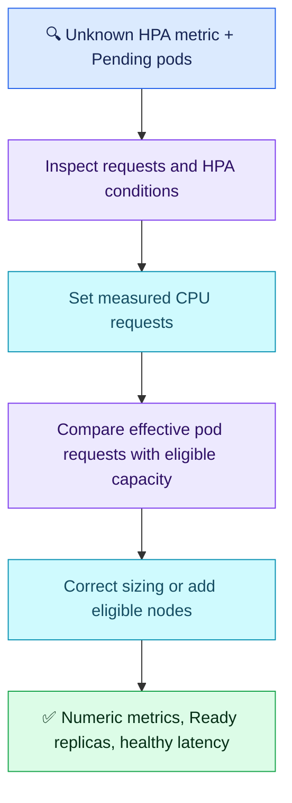

# Q12 — HPA metrics and scheduling capacity

## Scenario

Four EKS API replicas; CPU-utilization HPA shows `<unknown>/60%`. Metrics Server and top work. API container has no CPU request/limit. Two manually added pods remain Pending with Insufficient cpu despite low actual node usage. Teammate proposes higher limits and VPA to add replicas. Diagnose, mitigate and verify.

**Question clarification:** The API container's zero request alone cannot explain the CPU-fit failure. Inspect the live whole-pod effective request (other containers, init containers, applicable overhead/defaults). If the entire effective request is zero, the stated ordinary CPU-request capacity explanation is incomplete. No deduction for not challenging this underspecified premise.

## Evaluation — 2026-10-24

**7/10; acceptance estimate 65%** (subjective, answer-specific, not hiring probability). Follow-up 2/5; original scores preserved.

**Attempt:** Correctly rejected VPA for replica scaling and arbitrary CPU limits. Proposed developer-informed right-sizing, fixing resources for HPA, describing Pending pod events and enabling Cluster Autoscaler. Conflated requests and limits as the utilization denominator; did not explain low actual CPU versus reserved requests, autoscaler eligibility checks or measurable recovery.

**Credit:** HPA/VPA roles corrected; measured sizing intent, scheduler events and node-capacity mitigation are relevant.
**Deductions:** requests-versus-limits precision (1); missing request-based scheduling explanation (0.75); treating autoscaler enablement as sufficient without checking existing state/eligible capacity (0.5); recovery verification absent (0.75). No deduction for command volume, pod-event wording or the question ambiguity.

## Compact answer

> CPU utilization is usage divided by CPU request, not limit. I would inspect HPA conditions, set evidence-based CPU requests for the relevant containers and roll out through the normal deployment path. CPU limits are not required for this calculation. For Pending pods, I would compare their effective requests with eligible nodes' allocatable CPU minus already requested CPU; low live usage does not prove scheduling capacity. Check whether Cluster Autoscaler is already running and whether a matching node group can expand within its maximum, quotas and placement constraints. Add eligible capacity or correct genuinely oversized requests. Verify numeric HPA metrics, healthy conditions, replicas becoming Ready and stable latency/errors under representative traffic, followed by controlled scale-down.

Example: usage 300m / request 500m = 60%. A limit of 1000m does not change that percentage. Requests affect both scheduling and this HPA denominator; do not lower them merely to make pods fit.

## Essential commands

```bash
kubectl describe hpa <hpa> -n <ns>
kubectl describe pod <pending-pod> -n <ns>
kubectl describe node <eligible-node>
kubectl get hpa,pods -n <ns>
```

HPA conditions/events identify missing requests; pod details show live containers/requests and scheduling events; node Allocatable/Allocated resources show requested capacity. Final watch/check confirms numeric HPA metrics and Ready replicas; application metrics prove customer recovery. Placeholders identify affected objects; examples are read-only. Cluster Autoscaler logs/cloud node-group settings are the next evidence if expansion fails.



## Weakness recovery

| Earlier gap | Q12 result |
| --- | --- |
| Q11/Q11.1, AWS Q10 HPA versus VPA | Resolved in this attempt: distinguishes resource changes from replicas; retention reinforced |
| Q02/Q03 requests and capacity | Partially improved: right-sizing intent; denominator and reserved-versus-used precision missing |
| Q03 node autoscaler reasoning | Partially improved: node growth identified; eligibility/limits not demonstrated |
| Q11 recovery criteria | Unresolved: no explicit verification supplied |
| Storage, identity, networking gaps | Not reassessed |

Three main follow-ups remain (Q13–Q15); consolidated readiness review after Q15. Sources: [HPA](https://kubernetes.io/docs/concepts/workloads/autoscaling/horizontal-pod-autoscale/), [resource scheduling](https://kubernetes.io/docs/concepts/configuration/manage-resources-containers/).
