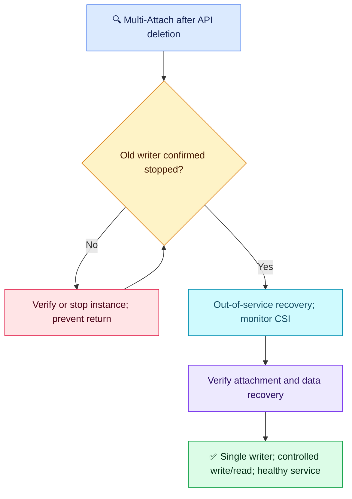

# Q13 — Safe EBS recovery after node failure

## Clarified scenario

An EKS StatefulSet uses a ReadWriteOnce EBS volume. A node becomes unreachable; someone force-deletes its Pod object without confirming the process stopped. The controller creates a replacement, scheduled in the same AZ but blocked by Multi-Attach. The old application may still run. A teammate proposes force-detaching EBS. Restore service safely and verify before writes.

The user correctly challenged the original missing replacement mechanism. That clarification is part of the question, not a deduction or scored answer. Unreachable alone does not normally allow a second StatefulSet pod with the same identity. API deletion does not confirm process death.

## Evaluation — 2026-10-24

**8/10; acceptance estimate 75%** (subjective, answer-specific). Follow-up 3/5; historical scores retained.

**Attempt:** Rejected immediate force detach; distinguished kubelet failure from EC2 failure; proposed checking instance state then out-of-service NoExecute taint, CSI health, event recovery, dashboards and VolumeAttachment inspection. Included both stopped/deleted and merely not-ready as triggers; did not explicitly verify data/application recovery before writes.

**Credit:** Relevant supported recovery mechanism, old-node investigation, CSI awareness and concrete attachment/event validation. Much stronger than Q05 storage reasoning.
**Deductions:** treating NotReady as potentially sufficient alongside verified stopped/terminated (1); no explicit filesystem/application consistency and single-writer gate before writes (0.75); no safe taint cleanup/rejoin check (0.25). No separate deduction for command syntax or component naming. No requirement for an exhaustive runbook.

## Compact answer

> I would confirm the old instance is powered off or terminated, not merely NotReady or restarting, and prevent it resuming as a writer. If only kubelet/networking failed, the process may still run. After shutdown is established, use the out-of-service recovery mechanism on the remaining Node object and monitor detach/attach reconciliation. Verify the old attachment is gone and the correct PVC/PV/EBS is attached to the replacement node. Before normal writes, complete the filesystem/application's supported crash-recovery and consistency checks, confirm a single writer, then test a controlled write/read and service health. Remove the taint only when the old node has recovered safely and stale workloads cannot return.

## Essential checks

Placeholders identify the affected instance, volume, node and pod. Read-only:

```bash
aws ec2 describe-instances --instance-ids <old-instance-id> --query 'Reservations[].Instances[].State.Name'
kubectl get volumeattachments
aws ec2 describe-volumes --volume-ids <volume-id> --query 'Volumes[].Attachments'
kubectl describe pod <replacement-pod> -n <ns>
```

EC2 state is shutdown evidence; VolumeAttachment maps PV to node (inspect the relevant object for details); AWS confirms actual attachment; pod events reveal CSI/mount failures. Use the appropriate account/region. Recheck CSI controller/node-plugin logs when reconciliation stalls, rather than assuming every failure means CSI pods are unhealthy.

**State-changing example — only after verified shutdown and preventing the old writer returning:**

```bash
kubectl taint nodes <old-node> node.kubernetes.io/out-of-service=nodeshutdown:NoExecute
```

The special taint enables force deletion of pods without matching tolerations and accelerated detach handling. It does not power off the node or gracefully stop an unreachable process. Control-plane controllers coordinate with CSI; reattachment is not guaranteed just because a taint exists. If the Node object is already gone, investigate remaining attachment state instead of tainting a nonexistent object. Remove the taint after safe node recovery, not simply after replacement startup.

Avoid manual force detach as a first response; if an approved last-resort recovery requires it, confirm shutdown and follow AWS filesystem check/repair guidance. Do not run filesystem repair blindly on a mounted, active volume. Snapshot/backup availability helps recovery but is not proof of consistency.



## Weakness recovery

- **Q05 storage recovery: partially improved significantly.** Supported same-AZ detach recovery and force-detach risk understood; strict shutdown prerequisite and data gate remain.
- **Q11/Q12 verification: partially improved.** Events and VolumeAttachment inspection are concrete; application data integrity and write/read confirmation absent.
- **Q07 PDB, cross-AZ migration, identity/networking:** not reassessed.

Sources: [Kubernetes node shutdown](https://kubernetes.io/docs/concepts/cluster-administration/node-shutdown/), [AWS EBS detachment](https://docs.aws.amazon.com/ebs/latest/userguide/ebs-detaching-volume.html).
