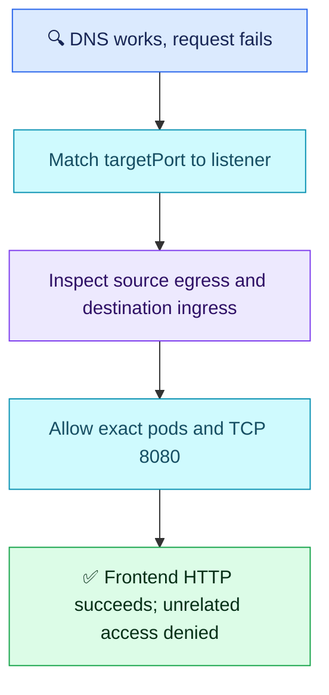

# Q14 — Service mapping and NetworkPolicy

## Scenario

Frontend in web calls `http://orders.backend.svc.cluster.local:8080`. DNS resolves, pods/endpoints are Ready. Service port 8080 targets 8081 while app listens on 8080. After correcting mapping, backend diagnostic requests work but frontend times out. Both namespaces have default-deny policies. Explain both faults, narrow access and frontend verification; teammate proposes deleting policies.

Diagnostic success assumes applicable allowance/non-isolation for that pod's traffic; same-namespace membership alone is not an exception to default deny. The prompt did not specify all policy rules. Do not penalize the candidate for not inventing those missing rules.

## Evaluation — 2026-10-24

**6.5/10; acceptance estimate 60%** (subjective, answer-specific). Use the completed answer, not the interrupted partial message. Follow-up 4/5.

**Attempt:** Rejected deleting policies; mentioned Calico/enforcement and allowing namespace workloads from either side. Acknowledged corrected port mapping and working DNS. Attributed backend success to same namespace/short DNS. Proposed exec plus nslookup of an HTTP URL to verify.

**Credit:** Security restraint, likely policy cause, awareness of both sides and DNS already working. Interpret “either side” generously as intent to consider both, not proof of an either/or misconception.
**Deductions:** no precise source-egress/destination-ingress and narrow pod/port scope (1); same-namespace/short-DNS explanation for access is wrong (1); DNS-only test cannot verify HTTP recovery (1); first port mismatch not explicitly explained (0.5). URL syntax is corrected without a separate penalty.

## Compact answer

> Fix targetPort to 8080 so Service port 8080 reaches the actual listener. Ready endpoints do not validate this mapping or network reachability. Keep default deny. Allow web frontend pods to reach backend orders pods on TCP 8080 through source egress and destination ingress. Use namespace and pod selectors together to avoid granting access to every workload. Backend diagnostic success proves that tested path only; short DNS does not bypass policy. Test the actual HTTP URL from a frontend pod, check expected status/body and latency, then confirm an unrelated workload remains blocked.

## Essential checks

```bash
kubectl get service orders -n backend -o yaml
kubectl get networkpolicy -n web -o yaml
kubectl get networkpolicy -n backend -o yaml
kubectl exec -n web <frontend-pod> -c <container> -- curl --max-time 5 -i http://orders.backend.svc.cluster.local:8080
```

Inspect Service port/targetPort and effective policy selectors/directions. Curl example assumes installed tooling and a valid application path; choose the real endpoint and expected response. If unavailable, use approved debugging tooling preserving the frontend's network/policy context. A generic debug pod may have different permissions. `nslookup orders.backend.svc.cluster.local` tests DNS only, without `http://` or `:8080`; DNS already works here, so it is not the recovery gate.

| Required allowance | Scope |
| --- | --- |
| Egress policy selects frontend pods in web | To namespace backend AND orders pod labels, TCP 8080 |
| Ingress policy selects orders pods in backend | From namespace web AND frontend pod labels, TCP 8080 |

Combine namespaceSelector and podSelector within one peer entry for AND semantics; separate entries are OR. Preserve required DNS egress; no reason to modify it when resolution already succeeds. Reply traffic is implicitly allowed for permitted connections. Calico is one enforcement option, not mandatory for every EKS cluster.



## Recovery comparison

- Q04 policy reasoning: partially improved; security preserved and both sides considered, but exact directions/selectors/port unproven.
- Q08 evidence-led DNS diagnosis: partially improved; acknowledged resolution works, but incorrectly attributed access to DNS naming.
- Q11–Q13 recovery verification: unresolved; nslookup does not test the failed HTTP operation.
- No independent mastery claim. Q15 remains; consolidated review afterward.

Source: [Kubernetes NetworkPolicy](https://kubernetes.io/docs/concepts/services-networking/network-policies/).
