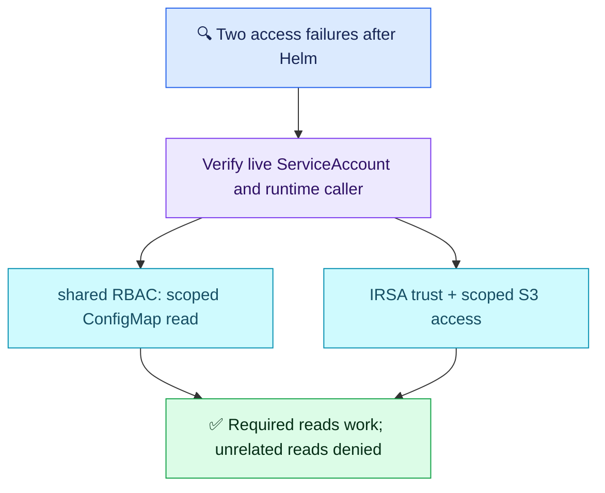

# Q15 — Kubernetes RBAC and AWS IAM boundaries

## Scenario

EKS reporting pod uses reporter ServiceAccount in analytics and IRSA. After Helm release, reading shared-namespace ConfigMaps returns Forbidden and reading one S3 prefix returns AccessDenied. Image pulls work. Teammate proposes cluster-admin and node-wide S3 permissions. Verify actual identities, grant narrow access and test allowed/denied operations.

## Evaluation — 2026-10-24

**6.5/10; acceptance estimate 60%** (subjective, answer-specific). Follow-up 5/5.

**Attempt:** Rejected cluster-admin/node permissions, checked Deployment ServiceAccount and role annotation, suspected Helm values drift, proposed role permissions and RoleBinding for ConfigMaps, then dashboards/container checks. Used working image pulls to narrow AWS diagnosis. Did not explicitly place the Kubernetes role/binding or prove runtime AWS identity and denied access.

**Credit:** Strong least-privilege intent, useful Helm/ServiceAccount/annotation investigation, awareness that RoleBinding alone cannot compensate for inadequate role rules. Interpret “role” for ConfigMaps as ambiguous, not proof that the user explicitly claimed IAM grants Kubernetes permissions.
**Deductions:** unclear RBAC/IAM boundary and missing target-namespace binding scope (1); image-pull inference plus missing runtime identity proof (1); no specific S3 prefix/action scoping (0.75); nonspecific recovery without allowed/denied operation tests (0.75). No extra deductions for command count or optional advanced controls.

## Compact answer

> These are two authorization paths. Inspect the live pod's serviceAccountName and compare Helm output with the deployed objects. For ConfigMaps, use a Kubernetes Role and RoleBinding in shared; the binding subject is reporter in analytics. Grant get on the required ConfigMap names, adding list/watch only if necessary. For S3, verify the runtime AWS caller and IRSA issuer/sub/aud trust, then scope GetObject to the required prefix; check explicit bucket/key policy denies when indicated. Successful image pulls do not prove runtime IRSA is correct. Apply the narrow fixes through the normal release path. From the workload, confirm the required ConfigMap/object reads work and unrelated reads remain denied, without logging secrets or object contents.

## Essential evidence

```bash
kubectl get pod <pod> -n analytics -o jsonpath='{.spec.serviceAccountName}'
kubectl describe sa reporter -n analytics
kubectl get role,rolebinding -n shared -o yaml
kubectl auth can-i get configmap/<required-name> -n shared --as=system:serviceaccount:analytics:reporter
kubectl exec -n analytics <pod> -c <container> -- aws sts get-caller-identity
```

Placeholders identify affected objects. can-i impersonation requires permission and is a policy check, not proof of the app's actual credentials. Runtime CLI assumes tooling and the same credential context as the application; otherwise use approved diagnostics through its SDK. Do not print JWTs/credentials. Verify real reads in the app context, including one unrelated ConfigMap and one outside-prefix object expected to be denied. Add ListBucket with prefix conditions only if listing is required; KMS decrypt only if relevant to encrypted objects.

| Access | Authority |
| --- | --- |
| ConfigMaps in shared | Kubernetes RBAC; Role/RoleBinding in shared, subject reporter/analytics |
| S3 objects | Runtime IAM role via IRSA; scoped object ARN and effective AWS policies |
| Normal EC2-backed EKS image pulls | Usually node image-pull credentials; separate from application IRSA |

Node-role exposure depends on metadata/credential isolation; not every pod automatically receives it, but broadening it is still the wrong fix. A correct annotation alone does not prove which credentials the process uses.



**Recovery:** Q06/AWS Q09 configuration mapping reinforced, runtime identity/trust still unproven; Q09 image-pull/runtime distinction unresolved; exact RBAC/IAM scope partly understood; verification still lacks explicit allowed/denied tests. Least-privilege restraint remains a strength, not proof of complete authorization diagnosis.

Sources: [Kubernetes RBAC](https://kubernetes.io/docs/reference/access-authn-authz/rbac/), [EKS ECR pulls](https://docs.aws.amazon.com/AmazonECR/latest/userguide/ECR_on_EKS.html).
