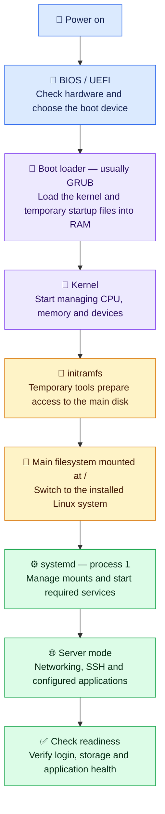

# 🐧 Linux Boot Process

**Booting = starting the machine, loading Linux and bringing up services.**
Typical flow for a modern server using systemd; details vary by setup.

## 🌈 From power-on to a running server

## 💡 Remember these points

- **Kernel** = Linux's core; **systemd** = the service manager. systemd may also run during the temporary startup stage.
- **`/`** = the main directory tree. Separate disks such as `/data` may mount later.
- **Services can start together** once their requirements are ready. Servers usually use `multi-user.target` — a group of services for normal server operation.
- **Boot completed ≠ application healthy.** Always verify the application itself.

## 🛠️ Quick checks

| Command | Purpose |
| --- | --- |
| `sudo journalctl -b` | Read current boot logs. |
| `sudo journalctl -k -b` | Check kernel startup messages. |
| `systemctl --failed` | Find failed services or mounts. |
| `systemd-analyze` | Check recorded boot duration. |

**Memory aid:** 🔌 Power → 🧭 Firmware → 🚀 Loader → 🧠 Kernel → 🧰 Temporary tools → 💾 Main disk → ⚙️ Services → ✅ Verify.

[Source: systemd boot-process documentation](https://man7.org/linux/man-pages/man7/bootup.7.html)
