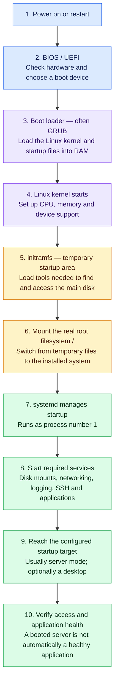

# Linux Server Boot Process

Booting means taking a machine from power-on to a running operating system and its services. This guide follows a typical modern Linux server using systemd. Virtual machines follow a similar path with virtual hardware; exact details vary by distribution and setup.

## 🌈 Complete flow

If your Markdown viewer does not render Mermaid, use this reading order:

**Power → BIOS/UEFI → boot loader → kernel → temporary startup files → main filesystem → systemd → services → login and health checks.**

## 🔎 Each stage in simple terms

| Stage | What happens | Why it matters |
| --- | --- | --- |
| **Power on** | The physical machine or virtual machine starts. | The boot process begins. |
| **BIOS / UEFI** | Built-in startup software checks essential hardware and selects where to boot from. BIOS is older; UEFI is the modern approach. | Linux has not started yet. A missing boot device can stop the process here. |
| **Boot loader** | A small program, commonly GRUB, selects a Linux version and loads its kernel plus temporary startup files into memory. It may show a menu. | It hands control to Linux. A previous kernel may be selectable when a new one fails. |
| **Kernel** | The core of Linux starts managing processors, memory and devices. A driver is software that lets Linux use a device. | Linux needs working device support to access storage and run programs. |
| **initramfs** | A small temporary filesystem in RAM supplies early tools/drivers. It can unlock an encrypted disk or prepare combined disks before locating the main filesystem. | The main disk may need preparation before its installed programs can be used. |
| **Real root filesystem** | The main filesystem is mounted as `/`. Startup switches from the temporary area to the installed system. | `/` is the top of the directory tree; it is different from the root administrator account. Separate filesystems such as `/data` may be mounted later. |
| **systemd** | The startup/service manager runs as process 1 and brings up the system according to its configuration. | It manages services, mounts and their dependencies. It may already have run inside initramfs and continue on the real filesystem. |
| **Services and mounts** | Required disks, logging, network components, SSH and enabled applications start when their prerequisites are ready. | Many can start in parallel. They do not all start in one fixed sequence. |
| **Startup target** | A target groups the services needed for a mode of operation. Servers commonly use `multi-user.target`; desktops commonly use `graphical.target`. | Reaching a target does not guarantee every application is healthy. SSH also needs a working network path and authentication. |
| **Operational checks** | Confirm login, required mounts, service health and real application requests. | A server can finish booting while a mount or application has failed. |

## 🧭 Where common failures happen

| Symptom | First area to investigate |
| --- | --- |
| No boot device found | Firmware boot selection and disk visibility. |
| GRUB prompt or boot-loader error | Boot files and boot-loader configuration. |
| Kernel panic or unable to find root filesystem | Kernel, storage drivers, startup files and root-disk identity. |
| Emergency/recovery shell | Read the failure message; required mounts or filesystem problems are possible causes. |
| `/data` is empty after reboot | Check whether the expected data filesystem mounted; do not format based on an empty directory. |
| Login works but application is unavailable | Application service, dependencies, configuration and network access. |

## 🛠️ Useful inspection commands

These are Linux study examples, not commands executed on this Windows workspace.

| Command | What it tells you |
| --- | --- |
| `sudo journalctl -b` | Logs from the current boot. |
| `sudo journalctl -k -b` | Kernel messages from the current boot. |
| `systemctl --failed` | Units currently marked failed. |
| `systemctl get-default` | Configured default startup target. |
| `systemd-analyze` | Recorded boot timing; available timing fields depend on the system. |
| `lsblk -f` | Disks, filesystem types, UUIDs and mountpoints. |
| `findmnt --mountpoint /data` | Whether `/data` itself is mounted. |
| `sudo journalctl -b -1` | Previous boot logs, if retained. |

If the machine cannot boot far enough for these commands, use the physical/cloud console or a recovery environment.

## 🧠 Important variations

- **GRUB is common, not compulsory.** Other boot loaders exist, and UEFI can load a suitable Linux image directly.
- **Secure Boot, when enabled, checks trusted signatures along the boot chain.** It is not a separate operating system startup stage.
- **initramfs is common, not universal.** Some systems can mount their root filesystem without a separate temporary startup image.
- **systemd is common on modern servers, not every Linux system.** Other startup managers use a different service-startup process.
- **Cloud VMs may run cloud-init** to apply instance configuration. It runs through configured stages and does not replace the kernel or service manager.

## 🎤 Short interview answer

> When a Linux server starts, BIOS or UEFI checks the machine and selects a boot source. A boot loader loads the kernel and usually an initramfs into memory. The kernel starts, and the temporary startup environment prepares and mounts the main filesystem. The system then runs its service manager, commonly systemd, which starts required mounts and services. Finally, I verify login access, required storage and application health, because completing boot does not prove that every service is working.

## Sources

- [systemd boot-process documentation](https://man7.org/linux/man-pages/man7/bootup.7.html)
- [systemd initial startup environment](https://github.com/systemd/systemd/blob/main/docs/INITRD_INTERFACE.md)
- [Red Hat kernel and boot configuration](https://docs.redhat.com/en/documentation/red_hat_enterprise_linux/8/html-single/managing_monitoring_and_updating_the_kernel/index)

Reference material only; this document does not count as an assessed question or change interview scores. Linux Q09 remains pending.
