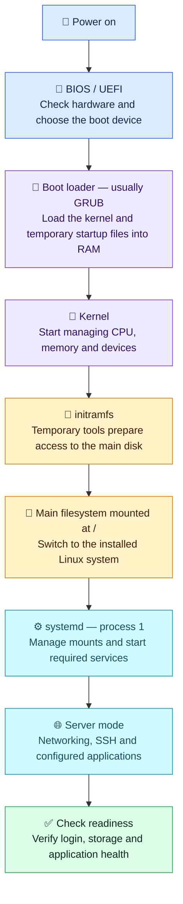

# 🐧 Linux Boot Process

**Booting = starting the machine, loading Linux and bringing up services.**
Typical flow for a modern server using systemd; details vary by setup.

## 👣 Read the stages first

- 🔌 **Power on:** The machine starts and runs its built-in startup software — BIOS or UEFI.
- 🧭 **BIOS / UEFI:** It checks essential hardware, selects a boot device and starts the boot loader.
- 🚀 **Boot loader:** Usually GRUB, it loads the Linux kernel and **initramfs** into RAM, then starts the kernel.
- 🧠 **Kernel:** Linux's core sets up CPU, memory and device support, then unpacks initramfs and runs its startup tools.
- 🧰 **initramfs (initial RAM filesystem):** A temporary filesystem in memory containing tools and drivers needed to find and access the main Linux filesystem. It can load storage drivers or unlock an encrypted disk so the main filesystem can be mounted next.
- 💾 **Main filesystem:** The startup tools mount it at `/`, the top of the directory tree, and switch from the temporary environment to the installed system.
- ⚙️ **systemd:** The installed system's service manager takes charge of starting required mounts and services in the right dependency order.
- 🌐 **Server mode:** Networking, SSH and configured applications start as their requirements become ready, making the server usable.
- ✅ **Verify readiness:** Finally, check login access, expected mounts and a real application request to confirm the server works as intended.

## 🌈 Visualize the same flow

## 💡 Remember these points

- **Kernel** = Linux's core; **systemd** = the service manager. systemd may also run during the temporary startup stage.
- **`/`** = the main directory tree. Separate disks such as `/data` may mount later.
- **Services can start together** once their requirements are ready. Servers usually use `multi-user.target` — a group of services for normal server operation.
- **Boot completed ≠ application healthy.** Always verify the application itself.

## 🛠️ Quick checks

| Command | Purpose |
| --- | --- |
| `sudo journalctl -b` | Read current boot logs. |
| `sudo journalctl -k -b` | Check kernel startup messages. |
| `systemctl --failed` | Find failed services or mounts. |
| `systemd-analyze` | Check recorded boot duration. |

**Memory aid:** 🔌 Power → 🧭 Firmware → 🚀 Loader → 🧠 Kernel → 🧰 Temporary tools → 💾 Main disk → ⚙️ Services → ✅ Verify.

[Source: systemd boot-process documentation](https://man7.org/linux/man-pages/man7/bootup.7.html)
