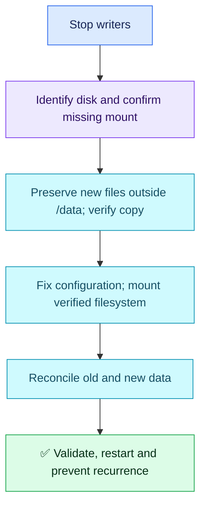

# Question 07 — Missing /data Mount After Reboot

## 🎯 Scenario

After reboot, /data looks empty and the application creates new files there. The expected disk is visible. A teammate suggests formatting and restoring. Recover both old and new data safely and prevent recurrence.

## ✅ Interview-Ready Answer

> I suspect the data filesystem did not mount, leaving the application writing into the underlying directory. I would stop writers, confirm disk identity and the mount state, and preserve the newly written files outside /data. I would investigate the boot mount failure, restore the verified existing filesystem without formatting, and reconcile the two datasets with the application owner. Before restart, I would confirm the correct filesystem and data, then verify application reads/writes. Persistent UUID-based mount configuration and a service mount dependency would prevent startup against the wrong directory.

## 🔄 Recovery Flow



## 🔍 Essential Commands

Illustrative only; not executed. Replace placeholders with verified paths/service names.

| Command | Purpose |
| --- | --- |
| `lsblk -f` | Identify filesystem, UUID and mountpoints; confirm the expected volume, not just any visible disk. |
| `findmnt --mountpoint /data` | Check whether /data itself is a mountpoint. |
| `findmnt --target /data` | Identify the filesystem currently backing that path; it may be the root filesystem. |
| `cat /etc/fstab` | Compare intended /data UUID, filesystem type and options with the actual disk. |
| `sudo journalctl -b -u data.mount` | Investigate boot failure for the systemd /data mount unit, where configured. |

### 🛠️ Preserve Before Mounting

**State-changing examples; coordinate service interruption first:**

```sh
sudo systemctl stop <application-service>
sudo rsync -a /data/ /verified-backup/new-data-before-mount/
```

Quiesce all writers, including workers. The destination must be outside /data, on verified storage with sufficient space and appropriate protection, preferably independent storage. Inspect rsync errors and verify copied contents/checksums before proceeding. Preserve additional ACL/xattr/hardlink metadata if the application requires it. Avoid --delete and never overwrite the old dataset blindly.

`rsync` copies files; it does not mount or map a disk. Mounting over /data hides the underlying new files; it does not automatically merge or erase them. That is why they must be preserved first.

### 🛠️ Restore and Prevent

- Correct the intended /etc/fstab entry using the verified UUID and filesystem type. If corruption or I/O errors appear, preserve a snapshot/image and use filesystem-specific recovery; do not blindly format or repair a mounted filesystem.
- Once identity/configuration and data preservation are verified, use `sudo systemctl daemon-reload` after fstab changes and `sudo mount /data` to mount only the intended entry. Mounting can modify filesystem metadata; it is not a forensic read-only operation.
- Confirm the source/UUID with findmnt and inspect old files. Reconcile new files deliberately; conflicting names and database files require application-aware recovery, not a generic rsync merge.
- Configure the application unit with `RequiresMountsFor=/data` alongside the valid mount definition. Add a startup check for the expected mounted filesystem/UUID; the dependency alone does not prove disk identity or create a missing mount definition.
- Verify old and new records, ownership, successful reads/writes and application health before resuming traffic. Test mount/startup ordering during an approved restart/reboot window and alert on mount failure.

## 📌 Takeaway

**A visible disk is not necessarily mounted. Preserve the underlying new files before restoring the old filesystem.**

## Attempt — 2026-10-10

Candidate correctly suspected a missing mount, rejected formatting, proposed lsblk and rsync to another path as backup. Described rsync as mapping a path. Did not specify stopping writers, confirming the mounted filesystem, a verified recovery/reconciliation sequence, persistent mounting or recovery validation.

**Score: 6/10 — four-year baseline.** Subjective answer-specific acceptance estimate: 55%, not hiring probability.

Credit: correct likely cause, data-loss awareness and backup intent. Deductions: 1.5 incomplete preservation/recovery sequence; 1 missing mount-state/identity confirmation and rsync semantics; 0.75 missing recurrence prevention; 0.75 missing recovery verification. No penalty for concise delivery or omitted advanced commands.

## References

- [findmnt path versus mountpoint checks](https://man7.org/linux/man-pages/man8/findmnt.8.html)
- [mount behavior and covered directory contents](https://man7.org/linux/man-pages/man8/mount.8.html)
- [systemd mount dependencies](https://man7.org/linux/man-pages/man5/systemd.unit.5.html)
