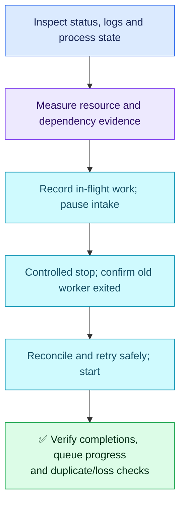

# Question 08 — Stalled Worker / Safe Recovery

## 🎯 Scenario

A systemd-managed worker remains running but stops completing jobs. Some jobs are partially processed. A teammate suggests kill -9. Investigate and recover without losing or duplicating work.

## ✅ Interview-Ready Answer

> I would inspect the service, recent logs, process state and resource use before assuming resource starvation. I would also check job progress and blocked dependencies. Before recovery, I would pause new consumption where supported and capture in-flight job IDs/checkpoints. I would use the service's documented graceful stop, review its shutdown timeout and confirm the old worker has exited before starting it again. I would reconcile partial jobs with the application's acknowledgement and retry behavior, then verify completed work, queue progress and absence of duplicate side effects. Linux signals alone cannot guarantee job correctness.

## 🔄 Flow



## 🔍 Essential Commands

Study examples only. Replace service and PID placeholders with the real unit and process.

| Command | Why / evidence |
| --- | --- |
| `sudo systemctl status <worker.service>` | Unit state and Main PID; active does not prove useful job progress. Use the unit name, not an arbitrary executable name. |
| `sudo journalctl -u <worker.service> --since "30 minutes ago"` | Correlate last completed job, errors and timeouts; logs may not expose the root cause. |
| `ps -p <pid> -o pid,stat,pcpu,pmem,wchan:32,cmd` | Inspect CPU/memory and process state/wait location. D-state suggests an uninterruptible wait; investigate the underlying I/O. |
| `vmstat 1` | Repeated runnable/blocked tasks, CPU and swap observations; syntax is 1, not -1. Use htop or iotop selectively if evidence points to CPU/memory or disk contention. |
| `sudo systemctl cat <worker.service>` | Inspect stop action, restart policy and timeout settings; inherited defaults may require checking effective configuration. |

## 🛠️ Safe Recovery

- If measured contention is the cause, reduce only approved nonessential workloads. Do not terminate unrelated processes based solely on high usage. A stuck dependency, lock or I/O path needs its own fix.
- Record in-flight job IDs and durable progress, and pause new job intake using the supported application mechanism. SIGTERM allows cleanup only if the application implements it; it does not guarantee a checkpoint or successful drain.
- **State-changing examples**, after confirming the recovery plan:

```sh
sudo systemctl stop <worker.service>
# Confirm old worker/children exited and reconcile in-flight work before starting.
sudo systemctl start <worker.service>
```

- Use systemd for its managed worker; killing a PID directly can trigger automatic restart. A stop normally uses configured graceful actions/signals but may escalate to SIGKILL after its timeout. Review this before acting and provide enough time for the supported shutdown behavior.
- SIGKILL is a last resort after evidence capture and an explicit partial-work recovery plan. It cannot be handled for cleanup; an uninterruptible wait may not end immediately even after a kill signal.
- `renice` changes CPU scheduling preference, not RAM allocation, I/O performance or deadlock state. Higher nice value means lower CPU priority; decreasing it may require privilege. Use it only for demonstrated CPU contention.

## ✅ Verify / Prevent

Confirm the intended worker count, new successful job completions, falling queue age/backlog and acceptable resource use. Check partially processed job IDs against durable outcomes and retry only according to application semantics. Acknowledgements, checkpoints and idempotent processing (retries do not repeat side effects) determine loss/duplication safety; involve the application owner where these are unclear.

Add alerts for stalled completion rate/queue age, not merely process existence. No Linux-only command proves exactly-once processing.

## Attempt — 2026-10-10

Candidate rejected immediate SIGKILL, used service status/logs and resource tools, proposed SIGTERM for unnecessary processes and correctly explained the direction of nice priorities. Recovery focused on resource contention without establishing it; did not describe stalled-worker lifecycle or partial-job reconciliation/verification.

**Score: 7/10 — four-year baseline.** Subjective answer-specific acceptance estimate: 65%, not hiring probability.

Credit: cautious signal choice, sound initial checks, useful monitoring and correct nice-value direction. Deductions: 1.5 for missing in-flight-job recovery/verification; 0.75 for incomplete managed-worker shutdown/restart handling; 0.75 for assuming contention and broadly proposing resource/priority changes. vmstat syntax is corrected as a minor slip with no separate deduction. Detailed queue implementation is not required, but recognizing recovery semantics is essential to the scenario.

## References

- [systemd stop signals and escalation](https://man7.org/linux/man-pages/man5/systemd.kill.5.html)
- [renice scheduling priority](https://man7.org/linux/man-pages/man1/renice.1.html)
