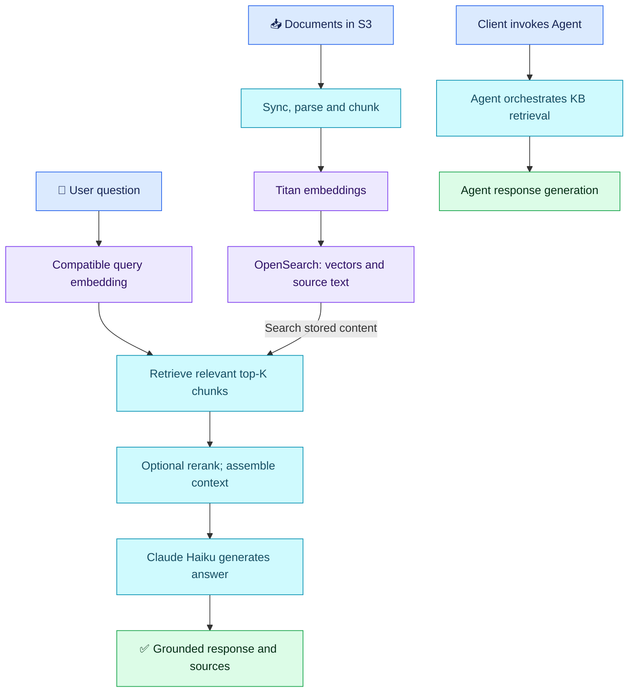

# RAG Q01 — Explain the Bedrock Chatbot

## 🎯 Question

Explain the résumé chatbot from S3 document upload to user answer. Identify Knowledge Bases, Titan Embeddings, OpenSearch, Claude Haiku and Agents; describe personal work and behavior when documents lack the answer.

## ✅ Interview-Ready Explanation

- 📥 **Ingestion:** Authorized contributors upload documents to S3. A sync/ingestion mechanism processes them. Knowledge Bases coordinates parsing and chunking; Titan Text Embeddings V2 converts the chunks into vectors stored with retrievable text/source information in the configured vector store.
- 🔎 **Retrieval:** The question is embedded using a compatible model/configuration. Knowledge Bases queries OpenSearch for relevant chunks, with configured filters/search settings and optional reranking.
- 💬 **Generation:** The selected generation model, such as Claude Haiku, receives the question and retrieved context and produces an answer. The answer is generated from evidence, not simply selected from the top-K chunks.
- 🤖 **Agent:** If the client invokes a Bedrock Agent, its orchestration can call the associated knowledge base and use the retrieved context in its response. A direct Knowledge Base API request is a different path; confirm which command your client uses.
- 🛑 **Insufficient evidence:** Design and test a response such as “I cannot answer from these documents.” Retrieval can return similar but irrelevant text, so empty-result handling alone is insufficient. Check relevance, source support and grounding; citations do not themselves guarantee correctness.

## 🔄 Two Connected Flows



Ingestion runs when data is processed/updated; it is not repeated for every user query. The diagram describes the architecture, not verified details of the user's live account.

## 🧠 Important Corrections

| Claim | Precise version |
| --- | --- |
| Upload automatically syncs | For the standard S3 connector, use Sync/StartIngestionJob or configured automation. Explain your actual trigger and how you monitor completion. Newer managed connector scheduling is configuration-dependent, not proof of immediate sync on every upload. |
| Splitting creates embeddings | Parsing/chunking produces text pieces; the embedding model produces their numeric representations. |
| Haiku performs vector search | The retrieval layer/vector store performs search. Haiku can support agent reasoning/query preparation and generates the final response. |
| Serverless means no responsibility | AWS manages servers/scaling for OpenSearch Serverless. The team still owns access/network policies, index compatibility, data lifecycle, monitoring and cost. Knowledge Bases supports different stores; confirm the actual collection type. |
| Every RAG needs a bi-encoder, cosine and cross-encoder | Dense embedding retrieval is common; the similarity function is index-dependent. A cross-encoder is one optional reranker design, not a mandatory RAG stage or a confirmed feature of this deployment. |
| Missing answer automatically means refusal | That is desired behavior to configure and evaluate, not a universal guarantee. Use unanswerable test questions and inspect retrieved evidence. |

## 🔧 Only the Relevant API Distinctions

| API | Purpose |
| --- | --- |
| `StartIngestionJob` / `GetIngestionJob` | Trigger and inspect standard data-source syncing. |
| `Retrieve` | Inspect retrieved chunks, scores and source information separately from generation. |
| `RetrieveAndGenerate` | Retrieve context and generate a response. |
| `InvokeAgent` | Invoke the configured agent; inspect its trace when diagnosing orchestration. |

No deployment commands executed. Confirm the actual CLI command/API, sync trigger, generation-model version, index similarity settings and whether reranking was enabled before claiming them in an interview. Do not share secrets or private documents.

## 💻 Asking a Question from Windows CMD

With AWS CLI v2 authenticated, Bedrock permissions granted and documents synced, query the KB directly. Replace `KB_ID` and `MODEL_ARN` with your KB ID and supported **generation model/inference-profile ARN**; use your configured AWS region/profile.

```bat
aws bedrock-agent-runtime retrieve-and-generate ^
  --input "text=How do I restart the payments service safely?" ^
  --retrieve-and-generate-configuration "type=KNOWLEDGE_BASE,knowledgeBaseConfiguration={knowledgeBaseId=KB_ID,modelArn=MODEL_ARN}" ^
  --query "output.text" --output text --no-cli-pager
```

- 🤖 **Your Agent setup:** A custom command such as `python ask_agent.py "Your question"` calls SDK `invoke_agent` with the agent/alias IDs and session ID, then prints the response. This requires a client script; it is not a built-in AWS CLI command.
- 🖥️ **Alternative:** Ask through the Bedrock console's KB or Agent test panel.

[AWS CLI reference](https://docs.aws.amazon.com/cli/latest/reference/bedrock-agent-runtime/retrieve-and-generate.html) · [Agent SDK reference](https://docs.aws.amazon.com/bedrock/latest/userguide/agents-invoke-agent.html). Illustrative examples, not executed.

## Attempt — 2026-10-11

Candidate reports implementing the whole setup with Knowledge Bases; S3 source, automatic upload sync, Titan V2, OpenSearch serverless, CLI/Agent usage. Correctly separated ingestion/query phases and described optional cross-encoder reranking. Attributed semantic search to Haiku, described answer selection from top-K, treated serverless as eliminating vector-store responsibility and assumed absence-of-evidence refusal. Claimed whole-setup ownership is recorded as user-reported; the résumé's narrower team-contribution wording is not used to invalidate it. Personal configuration decisions still need concrete examples.

**RAG overall: 6.5/10.** Subjective answer-specific acceptance estimate: 60%, not hiring probability.

Deductions: 1.5 for retrieval/generation role confusion and missing generated-answer step; 0.75 for unsupported default auto-sync certainty; 0.5 for serverless responsibility overstatement; 0.75 for assuming reliable refusal without a mechanism/test. Correct reranking reasoning earns credit; no penalty for missing command syntax, saying “Cloud” instead of Claude, or not covering MCP.

**Bedrock cross-topic subscore: 6/10**, separate from the RAG average. Deduction basis: 1.5 service-role/retrieval-generation distinction, 1 ingestion-trigger precision, 1 serverless responsibility, 0.5 incomplete Agent versus direct-KB path. No standalone Bedrock attempt is counted. MCP was not assessed.

## Sources

- [S3 connector and syncing](https://docs.aws.amazon.com/bedrock/latest/userguide/s3-data-source-connector.html)
- [Retrieval versus generation](https://docs.aws.amazon.com/bedrock/latest/userguide/kb-how-retrieval.html)
- [Titan embedding model](https://docs.aws.amazon.com/bedrock/latest/userguide/titan-embedding-models.html)
- [Reranking](https://docs.aws.amazon.com/bedrock/latest/userguide/rerank.html)
- [Knowledge Base security responsibilities](https://docs.aws.amazon.com/bedrock/latest/userguide/kb-create-security.html)
- [Agent operation](https://docs.aws.amazon.com/bedrock/latest/userguide/agents-how.html)
