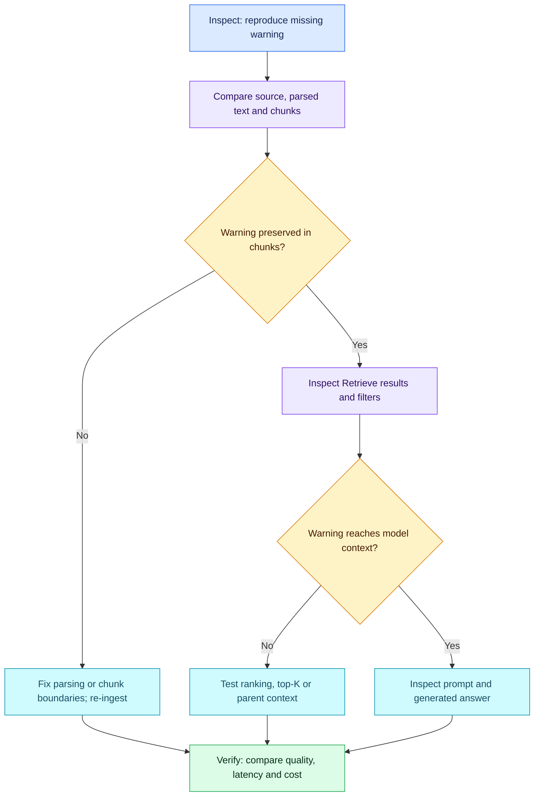

# RAG Q02 - Chunking and Retrieval Quality

## Question

Your Bedrock Knowledge Base ingests long operational runbooks from S3. The chatbot retrieves a procedure but frequently misses a warning or prerequisite from the same document, producing incomplete instructions. How would you investigate and adjust document processing/chunking, and demonstrate improved answers? Explain trade-offs rather than choosing a universal chunk size.

## Interview-Ready Answer

"I would reproduce a failing query and compare the original runbook, parsed text, stored chunks and `Retrieve` results. If parsing dropped a warning or table, I would fix extraction first. If a boundary separates the prerequisite from its procedure, I would test section-aware splitting, modest overlap or hierarchical retrieval. If the warning exists but is not retrieved, I would inspect filters, top-K and ranking. If it reaches the model but is omitted, I would inspect assembled context and generation instructions.

I would compare a baseline and candidate on a fixed set of runbook questions with expected procedures and mandatory warnings. I would measure evidence recall at K, answer completeness, source support, tokens, latency and cost. I would re-ingest into a test configuration, change one variable at a time, and promote only a measured improvement with a rollback path."

## Diagnostic Flow

## Decisions and Trade-offs

| Choice | Benefit and limitation |
| --- | --- |
| Section-aware/custom splitting | Keeps related instructions together; parsing must preserve headings, tables and warning relationships. |
| Overlap | Protects nearby boundary context; duplicates text and increases index/embedding work. It cannot guarantee inclusion of a distant prerequisite. |
| Small versus large chunks | Small chunks can improve specificity but fragment evidence; large chunks add context but can dilute relevance and increase generation tokens. Total cost depends on overlap, chunk count and retrieved context. |
| Hierarchical retrieval | Search child chunks, then supply broader parent context. A parent must actually contain the missing prerequisite. |
| Semantic splitting | Uses meaning to select boundaries; model requirements depend on implementation. A generative LLM is not universally required. |
| Sparse, dense or hybrid retrieval | BM25 and TF-IDF are distinct lexical scoring approaches. Dense search captures semantic similarity but may miss exact identifiers; similarity is index-dependent, not always cosine. Hybrid combines signals but is not inherently cheaper or better. |
| Metadata | Source, section and version help trace/filter evidence. A filename cannot substitute for the actual warning text; metadata must be deliberately exposed to generation if needed there. |

## Bedrock-Specific Application

- Use `Retrieve` to inspect source text and locations independently of generation; compare `RetrieveAndGenerate` with those results. No live API calls were executed.
- Standard Bedrock data sources configure one chunking strategy per source. Different sources or custom preprocessing can use different approaches; do not assume arbitrary simultaneous strategies on a single source.
- Bedrock hierarchical chunking retrieves child chunks and substitutes parent context. Semantic chunking exposes token, sentence-buffer and breakpoint settings; do not treat a generation-model upgrade as the default solution.
- Bedrock documents that the chunking strategy cannot be changed after data-source creation. Test a separate source/KB configuration as appropriate and re-ingest; preserve the working configuration for rollback and avoid duplicate indexed versions.
- Evaluate search type and `numberOfResults` within the deployed store's supported capabilities; do not change models, splitting and retrieval together without attribution.

## Attempt - 2026-10-12

Candidate identified poor boundaries/context loss; semantic, heading-aware and parent-child approaches; chunk size/cost trade-offs; overlap; model-dependent semantic splitting; lexical, dense and hybrid search; and source metadata. No concrete source-to-context inspection sequence, re-ingestion experiment or before/after evaluation was supplied. Candidate described dense/hybrid as better and hybrid as cost-efficient, and implied cosine universally; these require qualification. "Symantec" is interpreted as semantic and "chucking" as chunking, without deductions for spelling.

**Score: 7/10.** Answer-specific Interview Acceptance Probability: **65%**, a subjective coaching estimate, not a calibrated hiring probability.

Deductions: 1 for missing evidence-based fault isolation, 1.5 for missing a controlled validation plan and measurable improvement, 0.5 for unsupported retrieval quality/cost and similarity generalizations. Chunking options, overlap, metadata and trade-offs earn credit. No penalty for omitted advanced commands, MCP, or optional Bedrock configuration specifics. Semantic-model wording is conditional and receives clarification rather than a separate deduction.

Bedrock: partial cross-topic evidence on ingestion chunking options; no separate numeric subscore or new broad coverage credit because implementation-specific operations were not substantively demonstrated. MCP was not assessed.

## Sources

- [Bedrock chunking](https://docs.aws.amazon.com/bedrock/latest/userguide/kb-chunking.html)
- [Ingestion configuration](https://docs.aws.amazon.com/bedrock/latest/userguide/kb-data-source-customize-ingestion.html)
- [Retrieval settings and filters](https://docs.aws.amazon.com/bedrock/latest/userguide/kb-test-config.html)
