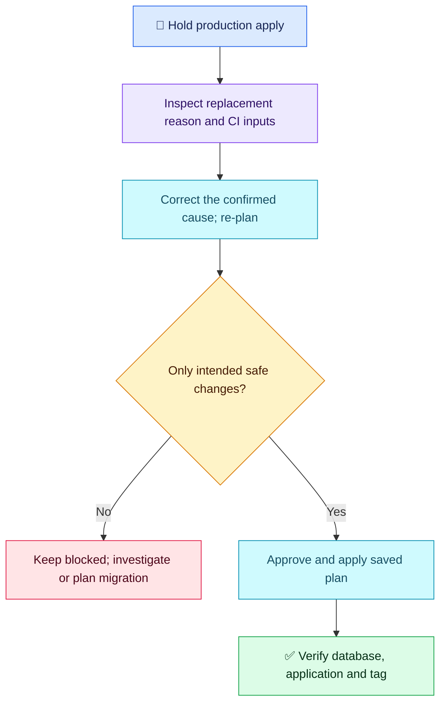

# Terraform Q01 — Unexpected Database Replacement

## 🎯 Scenario

A production tag change unexpectedly plans to destroy and recreate an existing AWS database. How do you investigate, decide whether to proceed and deliver the tag safely?

## ✅ Interview-ready answer

“I would stop the apply and inspect the exact replacement reason, rather than assume the tag is responsible. I would compare the resource diff and recent code/module/provider changes, confirm the intended environment and state, correct the cause, then review and approve a fresh saved plan. I would proceed only when the intended tag update is present without unexpected database replacement, and verify the database and tag afterwards.”

## 🔍 Diagnose before changing lifecycle rules

- Inspect the database's `-/+` replacement and `# forces replacement` attributes. If the plan instead shows separate removal/addition, compare resource addresses; a rename or changed `for_each` key can change identity.
- Check CI account, region, workspace/backend and variable inputs. Review module/provider versions and whether a shared variable changed an immutable argument as well as a tag. Check explicit replacement requests or tainted resources where the plan indicates them.
- Correct the evidenced cause: undo an unintended argument change, select the correct environment, or use a reviewed `moved` block for a genuine address refactor. Never blindly edit/remove state to hide a replacement.
- Re-plan: the tag must appear as an intended in-place change with no unexpected destroy/create. If replacement is genuinely required, separate it into an approved migration with tested backup/restore and cutover; do not bundle it with tagging.

## 🧠 Lifecycle correction

| Setting | Actual effect |
| --- | --- |
| `ignore_changes = [tags]` | Skips tag differences when planning updates to an existing resource. It does **not** apply your requested tag or stop replacement triggered elsewhere. |
| `prevent_destroy = true` | Rejects a destructive plan while the rule remains in configuration; a safeguard, not the underlying fix. Removing the resource configuration removes this protection. |

Tags can also drive access rules or automation; do not assume every tag is operationally harmless.

## 🔧 Essential pipeline commands

Run in the initialized, correct production configuration with the pipeline's normal inputs. Examples only; none executed here.

```bash
terraform validate                 # Check configuration consistency, not production safety
terraform plan -out=tfplan          # Produce the candidate change artifact
terraform show tfplan               # Inspect actual changes and replacement reasons
# After review and approval — changes infrastructure:
terraform apply tfplan              # Apply the exact approved plan
```

Protect saved plans as sensitive artifacts. If inputs/state change and a new plan is needed, review and approve it again. After apply, confirm the expected database identity, application connectivity and actual tag, then check for unintended remaining changes.

## 🔄 Decision flow



## Evaluation — 2026-10-17

**6/10 — Good production caution; diagnosis and lifecycle semantics need correction.** Answer-specific Interview Acceptance Probability: **55%**, a subjective coaching estimate, not a hiring probability. Four-year experience baseline.

**Full-answer summary:** Recognized database replacement/data-loss risk and small intended scope. Proposed ignoring tag changes while expecting Terraform to update the tag and prevent recreation. Added validate, plan review, CI execution and stakeholder approval before apply. Both messages are treated as one completed attempt, not two scores.

**Credit:** Risk awareness, reviewing a fresh plan, validation and an approval-gated production pipeline. No penalty for concise command coverage.

**Deductions:** 2 points for the central lifecycle misconception (including unsupported certainty that replacement disappears); 1.5 for not identifying the actual replacement reason before choosing a fix; 0.5 for missing post-apply verification. These are distinct gaps; lack of optional lifecycle safeguards is not separately penalized.

**Retest:** Interpret a concrete replacement diff; explain ignored updates versus destruction protection; confirm intended change and service health. Approval is valuable but cannot correct a misunderstood plan.

## Sources

- [HashiCorp lifecycle semantics](https://developer.hashicorp.com/terraform/language/meta-arguments/lifecycle)
- [Saved plans and review](https://developer.hashicorp.com/terraform/cli/commands/plan)
- [Validation scope](https://developer.hashicorp.com/terraform/cli/commands/validate)
