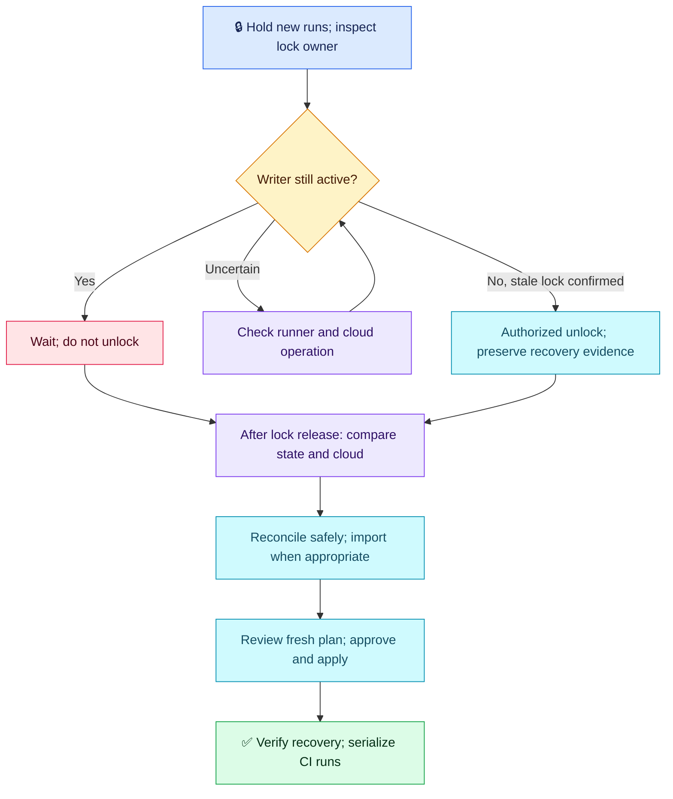

# Terraform Q02 — State Lock After an Interrupted Pipeline

## 🎯 Scenario

A production pipeline was interrupted. The next run cannot acquire the remote state lock. A teammate suggests disabling locking or immediately force-unlocking. Investigate, recover safely and prevent concurrent runs.

## ✅ Interview-ready answer

“I would hold new runs and match the lock ID, owner, operation and timestamp to the correct backend/workspace and CI runner. If its Terraform process is still running, I would wait; a failed job or lost connection alone does not prove it stopped. Only after confirming the owner is gone and automatic unlocking failed would an authorized operator remove that stale lock. I would preserve state versions and runner recovery artifacts, compare actual resources with state, import valid untracked resources when supported, and review a fresh normal plan before approved apply. CI concurrency must serialize runs for the same state.”

## 🔧 Essential checks and commands

Examples only; no infrastructure commands executed. Use the correct initialized backend, account and workspace; replace placeholders.

| Command/check | Purpose and condition |
| --- | --- |
| Lock error details + CI job/runner/process status | Identify the owner and prove whether a writer remains; inspect before unlocking. |
| `terraform plan -lock-timeout=5m` | Wait a bounded time for a legitimate active lock; keep locking enabled. |
| `terraform force-unlock LOCK_ID` | **Changes lock state:** only for a confirmed abandoned lock, with recovery ownership and competing runs paused. Does not repair state or stop a running apply. |
| `terraform state list` / `terraform state show ADDRESS` | Compare tracked objects/IDs against cloud resources and failed-run logs. |
| `terraform import ADDRESS RESOURCE_ID` | **Changes state:** adopt an existing intended, supported resource into its correct configured address instead of deleting it by default. |
| `terraform plan -out=tfplan` | Review remaining changes after recovery, including partial modifications and unintended replacement. |
| `terraform apply tfplan` | **Changes infrastructure:** execute the approved artifact through CI; verify resources/application and subsequent plan. |

Before state-changing recovery, preserve remote state versions and any runner-generated recovery state securely; never blindly push an old state snapshot. If a provider operation is still running in AWS, inspect its completion too.

## 🧠 Important distinctions

- **Lock scope:** protects a particular state from concurrent Terraform writers. It does not stop console changes or two different states managing the same object.
- **Partial apply:** Terraform may already have saved successful work; network failure does not prove missing state. Inspect evidence before repair. Read-only investigation is possible before unlocking.
- **Tracked resource changed:** a normal plan refreshes tracked resources by default. An optional reviewed `plan -refresh-only -out=refresh.tfplan`, followed by `apply refresh.tfplan`, records observed changes without changing infrastructure. It does not discover/import untracked objects.
- **Untracked resource exists:** import when appropriate and supported. Approved deletion/recreation is a fallback only after assessing data, dependencies and ownership. A later create may fail on a name collision rather than necessarily creating a duplicate.
- **Permissions:** force-unlock requires backend permissions and organizational authorization, not a universal Terraform “admin-only” role.
- **Prevention:** queue CI jobs by backend/state identity across workflows; keep backend locking, avoid cancelling an active apply, and retain protected state versions. S3 backend `use_lockfile = true` enables lockfile locking; it is not S3 Object Lock. DynamoDB locking is deprecated; migrate deliberately with compatible clients/permissions.
- **Audit:** combine CI plan/approval/run logs with CloudTrail. CloudTrail records configured AWS API events, not all Terraform reasoning; S3 state-object operations require appropriate data-event logging, which is not enabled by default.

## 🔄 Recovery flow

## Evaluation — 2026-10-17

**7/10 — Good lock reasoning and partial-apply awareness; recovery safeguards need refinement.** Answer-specific Interview Acceptance Probability: **65%**, subjective coaching, not hiring probability. Four-year baseline.

**Attempt summary:** Explained CI approvals, locking, coordinating with a concurrent deployer and waiting. Rejected disabling locks; identified S3/DynamoDB and native S3 locking. Discussed interrupted apply, comparing state with resources, safely deleting newly untracked resources, refresh-only for tracked changes, then reviewing normal plan/apply. Proposed force-unlocking first in the interrupted case, admin-only access and comprehensive CloudTrail auditing.

**Credit:** Active versus interrupted scenarios, concurrency purpose, avoiding lock bypass, reconciliation before apply and refresh-only awareness. Deletion was qualified as safe; it is not scored as indiscriminate deletion.

**Deductions:** 1 point for not explicitly proving the writer is stopped and the lock stale before force-unlock; 1 for defaulting to deleting untracked resources without considering import/preservation; 0.5 for missing concrete CI concurrency prevention; 0.5 combined for admin-only and complete-audit claims. No extra deduction for command enumeration or advanced recovery details.

**Retest:** stale-lock evidence, importing versus deleting, and CI concurrency. Refresh-only explanation has useful direction but should distinguish tracked-object refresh from import. No independent mastery inferred from this explanation.

## Sources

- [Force-unlock](https://developer.hashicorp.com/terraform/cli/commands/force-unlock)
- [S3 backend and locking](https://developer.hashicorp.com/terraform/language/backend/s3)
- [Import existing resources](https://developer.hashicorp.com/terraform/cli/import)
- [Plan and refresh-only](https://developer.hashicorp.com/terraform/cli/commands/plan)
- [S3 CloudTrail events](https://docs.aws.amazon.com/AmazonS3/latest/userguide/cloudtrail-logging-s3-info.html)
