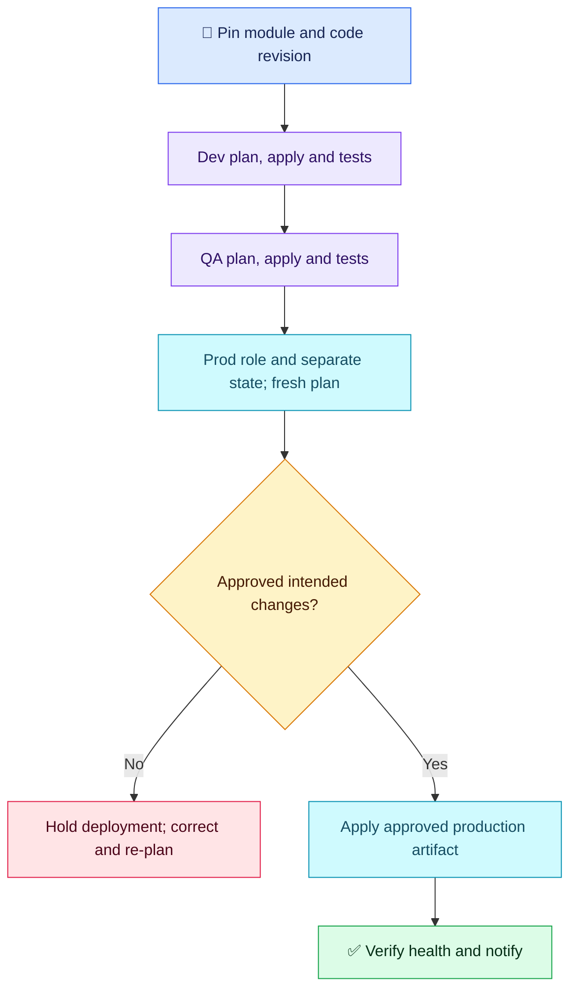

# Terraform Q03 — Modules and Environment Isolation

## 🎯 Scenario

Copied dev/QA/prod configurations drift apart, and a shared module update unexpectedly changes production. Organize reuse, control versions, promote safely and isolate state/credentials.

## ✅ Interview-ready answer

“I would keep thin dev, QA and prod root directories calling reusable modules with reviewed environment inputs. Each root gets a distinct remote state location and environment-scoped IAM role. I would pin the module release, test it in dev and QA, then explicitly promote that same revision to production with a new production plan and approval. Provider versions are controlled separately. OIDC supplies short-lived AWS credentials; secret values and state remain protected.”

## 🧩 Structure and version controls

| Layer | Practical choice |
| --- | --- |
| Environment roots | `environments/dev/`, `environments/qa/`, `environments/prod/`: small module calls, backend configuration and non-secret inputs. |
| Shared modules | Reusable resource definitions with typed inputs, useful validation and outputs. Review third-party modules; a verified publisher is not a safety guarantee. |
| Registry module | Pin an explicitly tested release with `version` in the module block. |
| Git module | Pin `source` using `?ref=COMMIT_SHA`; protected release tags are another controlled release mechanism. Avoid a floating branch for prod. |
| Local module path | Uses the module in the checked-out repository revision; no independent module `version` pin. Promote the tested repository commit deliberately. Directory separation alone does not freeze shared code. |
| Providers | Put constraints under `terraform.required_providers`; commit each root's `.terraform.lock.hcl`. The lock file selects providers, not module versions. The filename `provider.tf` is a convention; block placement matters. |

## 🔐 Isolation and secrets

- Give every root a distinct backend key/state (or separately secured backend). Directories alone do not prevent two roots using the same state. Retain locking/versioning and restrict state access to authorized roles.
- Use separate accounts where practical and distinct least-privilege environment roles. Bind GitHub OIDC trust to the approved repository/environment or branch; dev credentials must not be able to apply to prod. Verify the selected AWS account before planning.
- CLI workspaces separate state but do not automatically isolate credentials/access. Directory roots are a sensible choice here, not a universal requirement.
- Use reviewed environment input files for reproducibility. `-var` and `-var-file` are input mechanisms, not secret protection: CLI values can leak through logging/process inspection, and secret files need access controls and exclusion from Git.
- `sensitive = true` redacts ordinary display; it does not encrypt state. Secrets Manager values read into ordinary Terraform attributes can still reach state/plans. OIDC obtains AWS role credentials; Secrets Manager separately authorizes secret reads. Ephemeral/write-only features can avoid persistence where supported; do not assume all secrets must always enter state.

## 🚦 Promotion and essential commands

A single gated workflow or separate production workflow can both work. Manual dispatch alone is not an authorization boundary. Protect production permissions and approval gates; promote the tested module/code revision, but generate a separate plan for each environment. Never reuse dev's plan in prod.

```bash
# Illustrative CI commands for the production root; not executed here.
terraform -chdir=environments/prod init -lockfile=readonly
terraform -chdir=environments/prod validate
terraform -chdir=environments/prod plan -var-file=prod.tfvars -out=tfplan
# Only after the production plan is approved — changes infrastructure:
terraform -chdir=environments/prod apply tfplan
```

`init` installs selected dependencies without silently updating the committed provider lock; `validate` checks configuration; `plan` exposes the actual environment changes; `apply` uses that approved artifact. Afterwards verify resource/application health before reporting success. A failed rollout needs a reviewed recovery plan; reverting a module version does not automatically undo data changes.



## Evaluation — 2026-10-17

**7.5/10 — Sound structure and promotion approach; module versioning and explicit isolation need refinement.** Answer-specific Interview Acceptance Probability: **70%**, subjective coaching, not hiring probability. Four-year baseline.

**Attempt summary:** Proposed dev/QA/prod directories, shared local or registry modules, environment inputs, protected/encrypted state, sensitive-value awareness, provider consistency, dev/QA validation and a separate manually triggered approved production pipeline. Reported Secrets Manager with GitHub OIDC and short-lived role credentials. Suggested CLI variable/variable-file inputs and success notification.

**Credit:** Practical reuse and separation, workspace-selection risk awareness, CI approval, progressive testing, avoiding hardcoded secrets and recognizing state exposure. Personal OIDC/Secrets Manager experience is recorded as reported, not verified.

**Deductions:** 1 point for missing module release pinning/promotion (provider consistency does not solve the scenario's shared-module update); 0.75 for not explicitly separating backend locations and environment IAM/OIDC roles; 0.5 for provider-version placement and missing provider lock-file control; 0.25 for presenting variable injection as safe without its exposure/reproducibility caveats. No separate deductions for optional tooling, manual-trigger preference or advanced ephemeral features.

**Retest:** module versus provider version controls; local-path promotion; backend/role isolation. State/secret reasoning is broadly correct for ordinary Terraform values; qualify the absolute “always” persistence claim. Keep answers focused: structure, isolation, version pins, promotion and verification.

## Sources

- [Module sources and version selection](https://developer.hashicorp.com/terraform/language/modules/configuration)
- [Provider requirements](https://developer.hashicorp.com/terraform/language/providers/requirements)
- [Sensitive data and persistence](https://developer.hashicorp.com/terraform/language/manage-sensitive-data)
