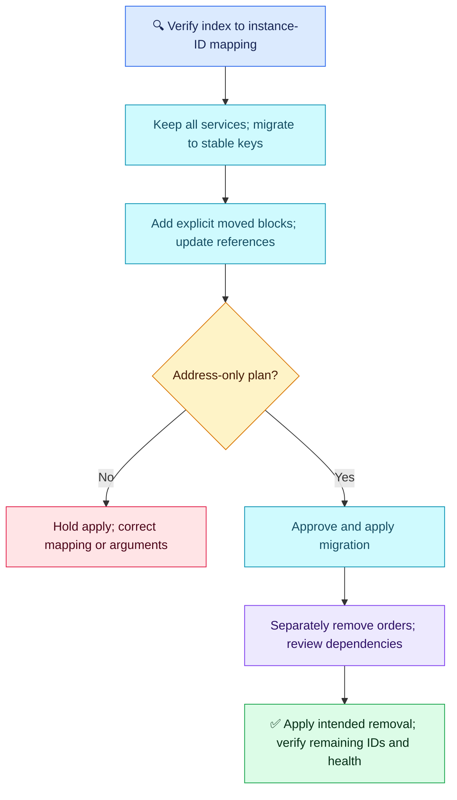

# Terraform Q04 — Count and Stable Resource Identity

## 🎯 Scenario

EC2 instances use `count` with `services = ["payments", "orders", "notifications"]`. Removing the middle service unexpectedly affects a service you wanted to keep. Explain and migrate safely.

## ✅ Interview-ready answer

“Terraform tracks these instances by numeric index. Removing orders shifts notifications from index 2 to 1, so Terraform changes the object at index 1 and removes index 2. I would hold apply, verify each address against its actual instance ID, then migrate to for_each with stable service keys and explicit moved blocks. I would first apply an address-only migration keeping all three services, then separately remove orders after reviewing its dependencies and confirming only the intended destruction.”

## 🔍 What changes?

| Address | Before | Desired after deleting orders from the list |
| --- | --- | --- |
| `aws_instance.service[0]` | payments | payments |
| `aws_instance.service[1]` | orders | notifications configuration |
| `aws_instance.service[2]` | notifications | No longer configured: destroy |

`count` is a **meta-argument**, not a function. Terraform matches addresses, not service-name tags. At index 1, a tag-only difference may update in place; an immutable argument may require replacement. Dependencies can also change, but they are not necessary to explain this problem. A planned code change is not automatically drift.

## 🛠️ Safe migration

1. Preserve a protected state backup/version and prevent competing applies. Inspect `terraform state list` and `terraform state show 'aws_instance.service[1]'` (shell quoting may vary) to confirm the existing IDs and original mapping. If a prior apply already changed them, reconstruct the actual mapping first.
2. Keep all three services during migration. Replace the existing resource's `count` and indexed references as below; preserve its other settings. This is an excerpt, not a complete EC2 configuration.

```hcl
variable "services" {
  type    = set(string)
  default = ["payments", "orders", "notifications"]
}

resource "aws_instance" "service" {
  for_each = var.services
  # Keep existing AMI, instance type, network and other arguments here.
  tags = { Name = each.key } # Merge with existing tags if present
}
```

Each service now has a stable key, such as `aws_instance.service["notifications"]`. Use a map and `each.value` when services need different settings; never use list positions as keys.
3. Add these blocks in the same module as the resource. They preserve address-to-object associations; they do not copy or recreate instances.

```hcl
moved {
  from = aws_instance.service[0]
  to   = aws_instance.service["payments"]
}
moved {
  from = aws_instance.service[1]
  to   = aws_instance.service["orders"]
}
moved {
  from = aws_instance.service[2]
  to   = aws_instance.service["notifications"]
}
```

4. Update dependent references to keyed addresses. Review an address-only migration plan: no unintended resource additions, changes or destruction. Apply that approved migration first.
5. Remove only the `orders` key in a separate change. Review dependent attachments and any drain/data requirements. Confirm payments/notifications retain their instance IDs and service health. Retain moved blocks for other environments still using the old addresses.

```bash
# Illustrative CI commands; none executed here.
terraform plan -out=tfplan     # Inspect moves and every proposed cloud change
# Only after approval — can change state/infrastructure:
terraform apply tfplan        # Apply the exact reviewed plan
```

Repeat plan/review/apply for the separate orders removal. Simply changing count to for_each without mapping addresses can cause destruction/recreation.

## 🧠 Lifecycle and dependency boundaries

- `ignore_changes` does not fix numeric identity or protect an instance whose index no longer exists. Use it only for a specific attribute intentionally managed elsewhere.
- `prevent_destroy` can reject destructive changes while configured. It is a selective safeguard, not universally compulsory and not a mapping fix; removing the resource configuration removes that protection.
- ASG-managed instance membership should normally be managed by the ASG rather than competing manual attachments. A changing target registration does not inherently require ASG replacement; inspect the actual resource diff.

## 🔄 Safe change flow



## Evaluation — 2026-10-17

**4.5/10 — Good review instincts, but the central identity problem and safe migration were missed.** Answer-specific Interview Acceptance Probability: **35%**, subjective coaching only, not hiring probability. Four-year baseline; this is question-specific, not a verdict on overall Terraform competence.

**Attempt summary:** Described count creating similar resources from list length and expected the removed service to be deleted. Attributed other changes to dependencies/ASG target registrations; proposed inspecting CI plans and conditional ignore_changes, and called prevent_destroy compulsory for critical production resources. Referred to previously discussed production safeguards.

**Credit:** Repetition/list-length understanding, potential dependency effects, reviewing the plan before apply and concern for critical resources. Minor “function” terminology is corrected without a separate deduction. Conditional ignore_changes suggestion is not treated as unconditional misuse.

**Deductions:** 2.5 for missing index shifting and assigning the main cause to dependencies; 2 for missing stable keys and address migration as the solution (one combined gap, not repeated penalties); 1 for relying on lifecycle rules without their limits and presenting prevent_destroy as compulsory. No penalty for not repeating earlier approvals or listing every command.

**Retest:** Explain the three addresses, preserve actual instance IDs during count-to-for_each migration and distinguish in-place changes from replacements. Include a fresh practical retest later within the 20-question limit.

## Sources

- [Count and index identity](https://developer.hashicorp.com/terraform/language/meta-arguments/count)
- [Refactoring and moved blocks](https://developer.hashicorp.com/terraform/language/modules/develop/refactoring)
- [Lifecycle limits](https://developer.hashicorp.com/terraform/language/meta-arguments/lifecycle)

## Q04 revised attempt — 2026-10-17

**8/10 — Core identity and migration concepts corrected; replacement behavior and migration verification need precision.** Answer-specific acceptance estimate: **75%**, subjective coaching, not hiring probability. Revision after reading the solution; preserve original 4.5/10. Not a new numbered question or independent retest.

**Response summary:** Identified count indices and trailing-resource risk; proposed stable for_each keys/each.key, keeping resource configuration unchanged and using a moved block to preserve resources. Incorrectly said changing an EC2 instance name can itself recreate it.

**Credit:** Correct cause, stable-key solution and explicit migration awareness. Saying “move” instead of `moved` is a minor terminology slip with no separate penalty.

**Deductions:** 1 for claiming a Name-tag-only change causes recreation; 1 for incomplete migration verification: map every original index to the correct key/instance ID, confirm an address-only plan and separately remove the unwanted service. Previously stated CI approval habits are credited, not penalized again.

**Precision:** The EC2 Name tag normally updates in place. Replacement depends on the changed argument or explicit replacement behavior. A `moved` block maps an old Terraform address to its new address; it is not a general deletion guard and cannot prevent replacement required by other argument changes. Stable keys help only while keys remain unchanged. Retest independently later.

Example mapping (repeat for every existing instance using its verified original identity):

```hcl
moved {
  from = aws_instance.service[2]
  to   = aws_instance.service["notifications"]
}
```

[AWS: tags on existing EC2 resources](https://docs.aws.amazon.com/AWSEC2/latest/UserGuide/Using_Tags_Console.html) · [HashiCorp: address migration](https://developer.hashicorp.com/terraform/language/modules/develop/refactoring).
