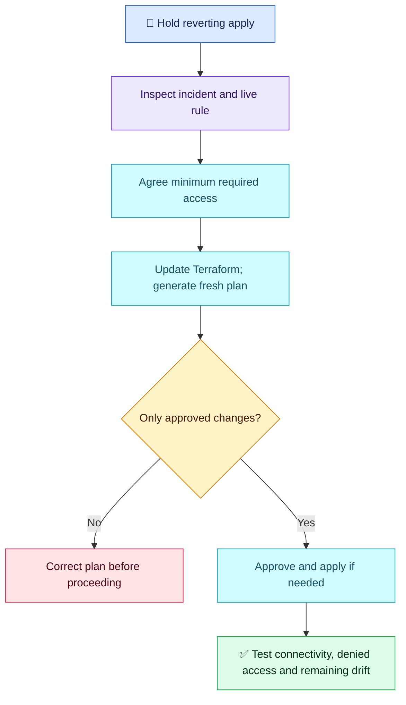

# Terraform Q05 — Emergency Security-Group Drift

## 🎯 Scenario

A manual security-group change restores production connectivity. Terraform proposes reverting it, but the application still needs access. Reconcile safely without retaining unnecessary permissions.

## ✅ Interview-ready answer

“I would hold the reverting apply, review the incident and actual rule change, and confirm the required source, destination, protocol and ports. I would encode only the approved minimum access in Terraform, review a fresh normal plan and apply it through CI if changes remain. I would verify required connectivity and denial of unwanted access, then check for remaining drift. Refresh-only can record observations in state, but cannot update the code or make a broad rule acceptable.”

## 🔍 Safe decision steps

1. **Investigate:** Compare Git configuration, the plan and live rules. Review incident/CloudTrail evidence with the owner: what changed, why, and whether access is temporary. Confirm the correct account and security group.
2. **Choose desired access:** Specify the actual source security group or necessary CIDR, destination workload, protocol and port. Do not copy an emergency all-sources/all-ports rule blindly. Retain only the required path; test a narrow replacement before removing broader temporary access where feasible.
3. **Reconcile code:** Update the existing Terraform rule representation. If a new separately managed rule exists outside state, adopt/import it when needed; refresh-only does not import it. Avoid managing the same rule twice or mixing competing inline and standalone management.
4. **Approve and verify:** Review the full plan for unintended changes, apply the approved artifact, test allowed and disallowed traffic, confirm application health and check a subsequent plan. Preserve a reviewed recovery path if narrowing access fails; avoid restoring unnecessarily broad access by default.

## 🔧 Essential commands

Illustrative pipeline commands; not executed here. Use the established production backend, role and input files.

```bash
# After updating code to the approved minimum access:
terraform plan -out=tfplan  # Refresh tracked resources and compare with desired code
# After approval, if changes are needed — modifies infrastructure/state:
terraform apply tfplan
```

Optional state-only recording, not a prerequisite for the workflow above:

```bash
terraform plan -refresh-only -out=refresh.tfplan
# After reviewing observed changes — updates state/outputs, not cloud rules:
terraform apply refresh.tfplan
```

A normal plan refreshes tracked objects by default. A separate reconciliation pipeline is optional; conditional/manual execution is also reasonable. Neither route removes the need to correct desired configuration. Avoid `ignore_changes` to hide security drift.

## 🔐 Emergency access

Restrict routine writes to approved deployment roles. Use an authorized, least-privilege, time-limited emergency role with an audit trail and prompt code reconciliation. The operator may be an authorized on-call engineer; broad administrator privileges are not inherently required. IAM governs API permissions, not simply whether someone clicks the console or runs a pipeline. Small rule changes can carry major security risk.

## 🔄 Recovery flow



## Evaluation — 2026-10-17

**7.5/10 — Correct state-versus-code reasoning; least-privilege investigation and recovery verification need detail.** Answer-specific Interview Acceptance Probability: **70%**, subjective coaching, not hiring probability. Four-year baseline.

**Attempt summary:** Advocated CI-based changes and restricted manual write access with an admin emergency exception. Proposed reviewed refresh-only reconciliation through separate or conditional CI, correctly explained that unchanged configuration would revert the rule again, then required code updates and normal plan/apply review.

**Credit:** Explicitly updates configuration, understands refresh-only cannot permanently fix desired-state mismatch, reviews changes before apply, and permits controlled emergency recovery. The opening prohibition was qualified later; no penalty for treating all emergency changes as forbidden. No command-volume penalty.

**Deductions:** 1.5 for not investigating the exact rule/incident and defining minimum source/protocol/port access (one combined security decision gap); 0.5 for treating a separate state-refresh operation as needed without explaining normal-plan refresh; 0.5 for missing post-change connectivity and unwanted-access tests. Admin terminology is coaching, not an additional deduction.

**Retest:** Choose a narrow replacement for a broad emergency rule; explain optional refresh-only versus normal planning and verify both positive/negative access. Q06 moves to dependencies; preserve this gap for a spaced retest.

## Sources

- [Terraform normal and refresh-only plans](https://developer.hashicorp.com/terraform/cli/commands/plan)
- [AWS security-group rule fields](https://docs.aws.amazon.com/vpc/latest/userguide/security-group-rules.html)
