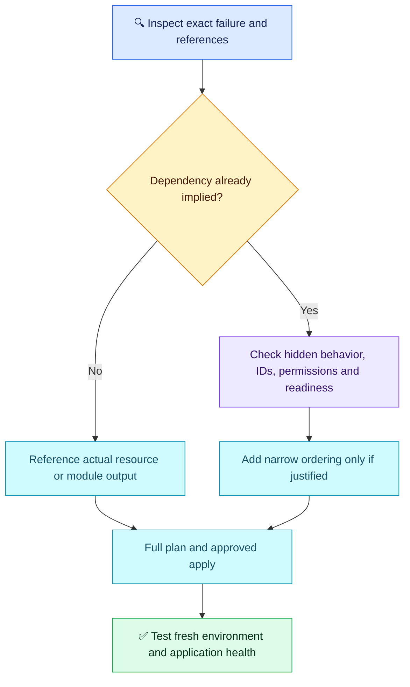

# Terraform Q06 — Dependencies and Creation Order

## 🎯 Scenario

A fresh VPC/subnet/EC2 deployment fails because a network dependency is not ready. A teammate suggests depends_on everywhere and sequential targeted applies. Investigate and fix ordering.

## ✅ Interview-ready answer

“I would inspect the exact failed API operation and resource references before assuming a missing dependency. Resource attribute references normally establish order automatically. I would replace hardcoded IDs with references to managed resources or module outputs, and add a narrow depends_on only for a genuine hidden dependency. Then I would review a full plan and verify the corrected configuration in a fresh test environment, including application startup.”

## 🔗 Implicit dependency: preferred

Excerpt: existing AMI variable, security and other resource settings omitted. Both resources belong to the same configuration; the VPC is defined elsewhere.

```hcl
resource "aws_subnet" "app" {
  vpc_id     = aws_vpc.main.id # Subnet waits for VPC
  cidr_block = "10.0.1.0/24"
}

resource "aws_instance" "app" {
  ami           = var.ami_id
  instance_type = "t3.micro"
  subnet_id     = aws_subnet.app.id # EC2 waits for subnet automatically
}
```

No extra depends_on is needed for this chain. Independent resources can still run in parallel. A subnet ID shown as `(known after apply)` is normal: the reference defines the dependency even before its value exists. Across modules, pass the network module's output into the compute module input; a copied ID string does not establish that relationship.

## 🧩 Explicit dependency: only for hidden behavior

If instance startup must download packages through a public internet route, subnet creation alone does not establish that route's readiness. Inside the existing instance resource, with the referenced resources defined in the same module:

```hcl
# Only when bootstrap actually requires this configured internet path:
depends_on = [
  aws_route.internet,
  aws_route_table_association.app
]
```

This adds ordering, not internet access by itself. The gateway, addressing and security rules must also be correct. A private instance may use NAT or endpoints instead. EC2 launch itself does not universally require an internet gateway or custom route association. Provider completion is not proof of application readiness; use appropriate startup retries and health checks.

## 🔍 Diagnose and verify

- Inspect the failing resource/API error and account/region. Distinguish missing subnet or wrong ID from route-dependent bootstrap failure, permissions, or eventual consistency.
- Trace references; use `terraform graph` if the relationship is unclear. Broad module-level depends_on can unnecessarily defer data-source reads, increase unknown values and serialize unrelated work.
- Do not make repeated `-target` applies the normal workflow. They can hide a broken graph; reserve targeting for exceptional recovery and follow with a full plan.
- Existing successful resources can remain after a partial apply. Reapplying may succeed, but that alone does not prove the configuration works from scratch.

```bash
# Illustrative CI commands; none executed here.
terraform plan -out=tfplan  # Review the full configuration after correcting dependencies
# After approval — changes infrastructure:
terraform apply tfplan
```

Validate a fresh isolated environment, actual networking and application health. Do not destroy production to test ordering.

## 🔄 Diagnostic flow



## Evaluation — 2026-10-17

**6/10 — Understands selective ordering, but misses implicit dependencies and diagnostic isolation.** Answer-specific acceptance estimate: **55%**, subjective coaching, not hiring probability. Four-year baseline.

**Attempt summary:** Rejected depends_on everywhere and unnecessary targeting; correctly described a list of dependency addresses and prerequisite ordering. Claimed all listed networking components must complete before EC2 launch, proposed explicit EC2 dependencies and retrying over already-created infrastructure. Did not explain attribute-reference dependencies or investigation of the actual error.

**Credit:** Selective dependencies, parallelism for independent work, list syntax and avoiding routine targeted deployment. No penalty for omitting a code snippet or repeating earlier approval steps.

**Deductions:** 2 for missing implicit references and the hidden-dependency criterion; 1 for treating all network components as EC2 launch prerequisites; 1 for missing failure/graph investigation and relying on retry rather than demonstrating fresh-environment correctness. Unknown-value and data-source details are coaching, not extra deductions.

**Retest:** Identify implicit dependencies in HCL, distinguish instance launch from bootstrap readiness and justify one hidden dependency. Cover remaining variable/type-validation breadth next.

## Sources

- [depends_on and planning consequences](https://developer.hashicorp.com/terraform/language/meta-arguments/depends_on)
- [Implicit and explicit resource dependencies](https://developer.hashicorp.com/terraform/tutorials/configuration-language/dependencies)
- [AWS internet connectivity requirements](https://docs.aws.amazon.com/vpc/latest/userguide/VPC_Internet_Gateway.html)
