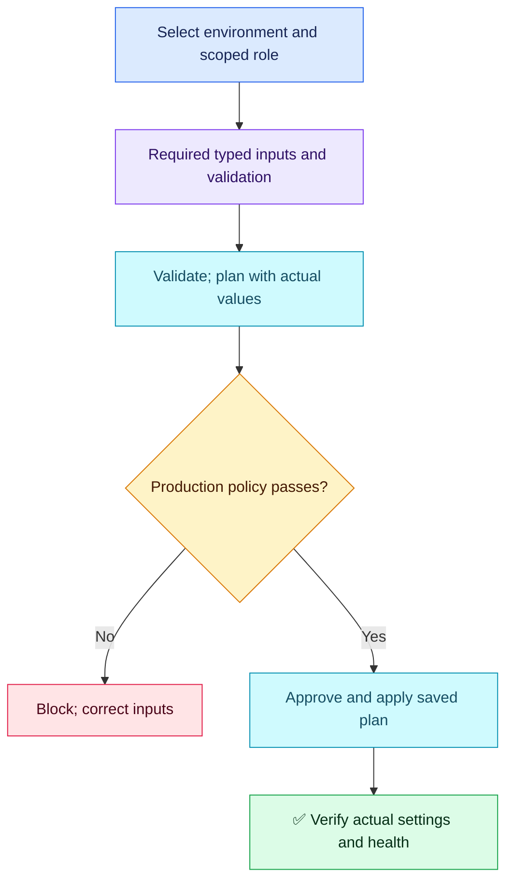

# Terraform Q07 — Module Input Validation

## 🎯 Scenario

Invalid module inputs fail only at apply; an omitted input selects development-sized instances in production. Catch mistakes early while preserving reuse.

## ✅ Interview-ready answer

“I would make critical inputs required, define types and validation rules, and avoid development defaults for production-critical settings. The pipeline must select the intended environment, role and inputs explicitly. I would run validate, then a plan with actual environment values, and enforce production policy against structured plan JSON. Approval and cloud/application checks remain necessary.”

## 🧩 Minimal module input contract

This excerpt demonstrates a required, non-null input and an IPv4 CIDR check. No default means omission cannot silently choose a small instance. The resource consuming these values is omitted.

```hcl
variable "instance_type" {
  type     = string
  nullable = false
  # No default: caller must choose explicitly.
  validation {
    condition     = length(trimspace(var.instance_type)) > 0
    error_message = "Provide an explicit, non-empty instance type."
  }
}

variable "network_cidr" {
  type     = string
  nullable = false
  validation {
    condition     = can(cidrnetmask(var.network_cidr))
    error_message = "Provide a valid IPv4 CIDR."
  }
}
```

Also require a typed environment input and validate permitted names. Constrain sizes/storage ranges according to the module contract. Keep organization-specific production allowlists in the environment wrapper or enforced policy; a syntactically valid instance type does not prove adequate capacity. CIDR syntax alone does not prove AWS-supported prefix size, containment or absence of overlap. Add relevant checks and negative test cases, not a universal instance-size rule.

## 🔍 Which layer catches what?

| Layer | Purpose and limits |
| --- | --- |
| `terraform validate` | Syntax and internal consistency, including attribute names and types; not just syntax. Does not validate a particular live environment or prove runtime sizing. |
| Input validation / plan | With actual known values, rejects missing required inputs and invalid values; checks planned changes. Conditions depending on unknown values may wait until apply. |
| Plan policy | Enforces production-specific instance/storage/access rules; treat unknown critical values explicitly rather than silently passing them. |
| Cloud and runtime checks | Permissions, quotas, regional availability, CIDR relationships, actual capacity and application health; a successful plan is not a deployment guarantee. |

## 🔧 Pipeline checks

Illustrative commands in an initialized root; not executed here. `prod.tfvars` holds reviewed non-secret configuration; Python policy logic is implementation-specific.

```bash
terraform validate
terraform plan -input=false -var-file=prod.tfvars -out=tfplan
terraform show -json tfplan > plan.json
# Policy gate reads plan.json; then approval — changes infrastructure:
terraform apply tfplan
```

Parse structured JSON instead of human-readable logs. Protect the saved plan and JSON because they can expose sensitive values. Fail the gate before approval on policy violations, and apply the same reviewed artifact. Verify the resulting configuration and health afterwards.

## 🔐 Environment boundaries

- GitHub environment variables or reviewed tfvars suit non-secret settings. Secrets Manager/Vault suit secrets; storing every configuration value there is not inherently best.
- Environment variables are not automatically Terraform inputs: explicitly pass them through module arguments, variable files or TF_VAR values. Bind the CI job to the intended GitHub environment and scoped role; assert the destination account.
- OIDC supplies short-lived AWS credentials, not validation that the fetched value belongs in production. Scope trust and secret access; wrong mappings/defaults remain possible. Separation reduces risk but never guarantees no mixing.



## Evaluation — 2026-10-17

**6.5/10 — Useful CI safeguards; module input contract remains the main gap.** Answer-specific acceptance estimate: **60%**, subjective coaching, not hiring probability. Four-year baseline.

**Attempt summary:** Parameterized environment settings; proposed Secrets Manager or GitHub environment variables, OIDC role credentials, Python plan-log checks and stakeholder approval. Claimed separation eliminates mixing and validate checks only syntax. Did not specify required/no-default inputs, types or validation conditions.

**Credit:** Module reuse, environment-specific inputs, reduced credential exposure, practical pre-apply policy checking and human approval. Python checking earns credit even though structured JSON is preferable. No separate penalty for missing HCL syntax.

**Deductions:** 2 for missing required inputs/type/custom validation and avoiding unsafe defaults (one contract-design gap); 0.75 for syntax-only characterization of validate; 0.5 for guaranteeing environment correctness through storage/OIDC separation; 0.25 for parsing human logs instead of structured plan JSON. Optional advanced tests and cloud checks are coaching, not extra deductions.

**Retest:** Design a required input and a failing validation case; distinguish authentication from environment-value correctness; use structured policy evidence. All 12 broad coverage groups have now been attempted, not mastered. Continue within the agreed 20 questions, covering untested subtopics and independent retests.

## Sources

- [Module input variables](https://developer.hashicorp.com/terraform/language/values/variables)
- [Validate scope](https://developer.hashicorp.com/terraform/cli/commands/validate)
- [Structured plan JSON and sensitive values](https://developer.hashicorp.com/terraform/cli/commands/show)
