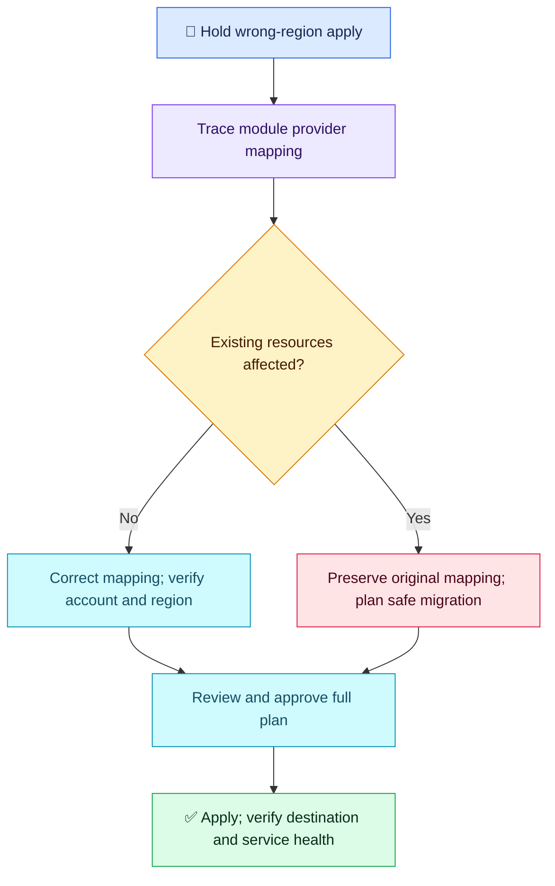

# Terraform Q08 — Provider Aliases and Module Regions

## 🎯 Scenario

A module intended for a secondary AWS region plans resources in the default region. Correct its provider mapping, verify the destination and preserve existing resources.

## ✅ Interview-ready answer

“I would hold apply and trace the root provider configuration, the module's providers map and its resources' provider references. Aliases are not automatically inherited by child modules. I would explicitly map the secondary configuration into the module, verify its effective account and region, and inspect existing state/real resources before changing any deployed mapping. Changing a region does not migrate infrastructure.”

## 🧩 Minimal mapping

Root excerpt; provider requirements, authentication and module inputs omitted. Regions are examples. Both configurations use the same AWS provider plugin.

```hcl
provider "aws" {
  region = "us-east-1"
}

provider "aws" {
  alias  = "secondary"
  region = "us-west-2"
}

module "dr" {
  source = "./modules/app"
  providers = {
    aws = aws.secondary
  }
}
```

**Left `aws`:** the child's provider name. **Right `aws.secondary`:** the parent's actual configuration. Root-level individual resources select it with `provider = aws.secondary`.

The child declares its own `required_providers` source/version requirements, but uses ordinary AWS resources without embedding its own provider configuration. It does not need `configuration_aliases` merely because the parent passes an alias as its default `aws`. If the child itself refers to a named configuration such as `aws.destination`, it must declare that name in `configuration_aliases` and the parent must map it explicitly.

## 🔍 Verification and existing resources

- Run `terraform providers` to inspect provider requirements and `terraform plan -out=tfplan` to inspect changes; neither alone proves the effective account/region of every alias. Check provider inputs and any supported resource-level region overrides.
- Use `aws_caller_identity` and `aws_region` data sources bound to the intended provider, then enforce/check their results in CI. A plain CLI identity check may use different credentials from a provider's assume-role configuration. Where appropriate, use AWS provider `allowed_account_ids` as an additional guard.
- Compare tracked IDs/ARNs and live resources in both regions. If nothing was deployed, correct the mapping and review the new plan. If resources already exist, do not blindly repoint their provider or remove their state records.
- Keep the original regional configuration available for resources it manages. Build the new region through an explicit deployment/migration, replicate data, test, cut over and only then retire the old resources with approval. Import existing destination resources only after ownership and configuration matching are established.
- Apply the approved saved plan through CI; confirm actual region/account, resource identity and DR functionality afterwards. Aliases select configurations; they are not security boundaries or data-migration mechanisms.



## Evaluation — 2026-10-17

**6.5/10 — Correct alias concept; module wiring and existing-resource handling remain incomplete.** Answer-specific acceptance estimate: **60%**, subjective coaching, not hiring probability. Four-year baseline.

**Attempt summary:** Proposed regional provider configurations with aliases, selecting the alias for resources, checking the plan's target region and CI/security/approval gates. Mentioned DR as the use case. Did not explain child-module provider mapping, concrete identity verification or handling already-deployed resources.

**Credit:** Correct direction on aliases and regional configuration, explicit distinction of alias value, review before apply and prior production safeguards. No penalty for concise wording, omitted code or not repeating previous gates. “Multiple providers” is clarified as configurations of the same plugin, not penalized separately.

**Deductions:** 1.5 missing explicit module providers mapping/inheritance; 1 missing concrete account/region verification beyond logs; 1 missing existing-resource migration safeguards. Advanced configuration_aliases detail is coaching, not a separate deduction.

**Retest:** Map a parent alias to a child default; verify effective account/region and explain why region changes do not move deployed resources. Next question revisits state recovery using concrete import evidence.

## Sources

- [Providers within modules](https://developer.hashicorp.com/terraform/language/modules/develop/providers)
- [Module providers mapping](https://developer.hashicorp.com/terraform/language/meta-arguments/providers)
