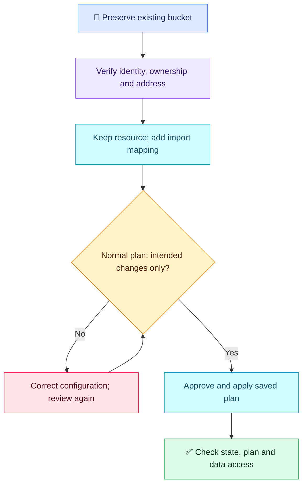

# Terraform Q09 — Import an Existing S3 Bucket

## 🎯 Scenario

A failed production apply created a bucket containing application data, but it is absent from the reviewed state inventory. Its resource block remains in Git; the next plan proposes creating it again. Adopt the correct bucket safely and verify the result.

## ✅ Interview-ready answer

“I would preserve the bucket, verify the intended account, bucket identity and Terraform address, and confirm it is not managed by another state. I would keep its resource configuration and add an import block. Through the existing locked, approval-gated pipeline, I would review a normal saved plan for import and any accompanying changes, correcting unintended changes before applying. Afterwards I would verify the state mapping, a normal plan and application access.”

## 🧩 Keep the resource; add the mapping

Illustrative excerpt: replace the bucket name/address with verified values; retain the existing resource's intended settings. Provider/backend configuration is omitted.

```hcl
resource "aws_s3_bucket" "app" {
  bucket = "existing-application-bucket"
}

import {
  to = aws_s3_bucket.app
  id = "existing-application-bucket"
}
```

The resource describes the desired configuration; the import block maps the existing object to that resource address. It does not replace the resource or copy every setting into configuration.

```bash
terraform plan -out=import.tfplan
# Review the full plan; approve only the intended import and changes.
terraform apply import.tfplan
terraform state show aws_s3_bucket.app
terraform plan
```

**Purpose:** the first plan previews adoption and any configuration differences. Applying the approved saved plan changes state and can change infrastructure if the plan includes updates. State inspection verifies the bucket ID; the final plan checks remaining differences. Protect plan/state files as sensitive artifacts.

- **Before apply:** verify the backend/workspace, provider account/region, exact bucket and destination address (including module/key when relevant). Avoid duplicate ownership; retain state recovery/versioning and normal locking.
- **Refresh-only is not import:** it refreshes already tracked resources; it cannot adopt this untracked bucket. Import does not guarantee a no-change plan—configuration and actual settings must agree.
- **Preserve data:** stop on unintended replacement/deletion or security changes. Verify existing objects and application access afterwards. Separately managed bucket policies/versioning resources may need their own configuration/import; importing the bucket alone does not adopt them all.
- **CI:** an on-demand import path is reasonable, but a separate pipeline is optional. Use the same scoped credentials, locking and plan approval controls. No bucket deletion or recreation is needed.



## Evaluation — 2026-10-17

**6/10 — Correct preservation decision; import execution needs correction.** Answer-specific Interview Acceptance Probability: **55%**, a subjective coaching estimate, not a calibrated hiring probability. Four-year baseline.

**Attempt summary:** Identified the missing-state create proposal and bucket-name collision; chose import to preserve application data. Proposed replacing the resource with an import block, then refresh-only plan/apply, expecting no drift afterwards. Suggested controlled on-demand CI reconciliation.

**Credit:** Import instead of deletion improves the Q02 recovery decision. Correct missing-state diagnosis, data preservation, follow-up planning and CI controls. Bucket uniqueness wording is not separately penalized.

**Deductions:** 1.5 for replacing the necessary existing resource configuration; 1.5 for refresh-only instead of normal import plan/apply; 1 combined for assuming import guarantees no drift and omitting proof of the exact mapped object. No extra deduction for omitted command syntax or optional tooling.

**Retest:** Q02's preservation gap improved independently; import mechanics and verification remain unresolved. Keep both historical scores. Next Q10 rotates to provider version/lock-file reproducibility before the interim checkpoint.

## Sources

- [HashiCorp: importing existing resources](https://developer.hashicorp.com/terraform/language/import)
- [HashiCorp: normal and refresh-only planning](https://developer.hashicorp.com/terraform/cli/commands/plan)
