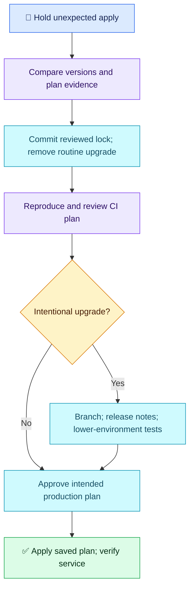

# Terraform Q10 — Provider Locks and Reproducible CI

## 🎯 Scenario

The same commit gives no changes locally but production changes in fresh CI. Backend/account are correct. AWS uses `~> 5.0`, Git ignores `.terraform.lock.hcl`, and every CI run executes `terraform init -upgrade`. A teammate wants approval because code is unchanged. Investigate, restore reproducibility and introduce upgrades safely.

## ✅ Interview-ready answer

“I would hold the unexpected apply and compare the actual provider versions, lock files and plan differences between laptop and CI. The constraint allows different 5.x releases; it does not select one exact release. I would commit the reviewed lock file, remove routine upgrade initialization, and reproduce the plan using matching inputs and tooling. Intentional upgrades go through a separate change: review release notes and lock-file differences, test in lower environments, then approve the production plan.”

## 🔍 Essential workflow

Run in the correct Terraform root. These are examples, not commands executed against infrastructure.

```bash
terraform version
```

Compare installed Terraform/provider versions in both environments, initialization output, and the exact proposed resource changes. Match variables, module revisions and state context too; a provider mismatch is evidence to investigate, not proof that every difference is safe.

Commit `.terraform.lock.hcl` after removing its ignore rule; keep `.terraform/` ignored. Normal CI:

```bash
terraform init -lockfile=readonly
terraform plan -out=tfplan
# Only after reviewing and approving this saved plan:
terraform apply tfplan
```

Read-only initialization enforces existing provider selections/checksums without silently rewriting the lock file. A missing/incompatible selection must be corrected through review. Inspect the new plan before approving: reproducing dependencies does not eliminate real drift.

For an intentional upgrade branch only:

```bash
terraform init -upgrade
git diff -- .terraform.lock.hcl
terraform plan -out=upgrade.tfplan
```

Review release notes and actual plan changes, test approved changes in a lower environment, and commit the tested dependency selection. Generate/review a separate production plan; do not reuse the lower-environment plan artifact. Verify service behavior after applying.

**Key distinctions:** `~> 5.0` permits `>= 5.0.0, < 6.0.0`; upgrade still respects constraints. The lock file records provider versions/checksums, not module versions or state locking. Pin module revisions and standardize the Terraform CLI separately. Commit the lock file, not potentially sensitive runtime logs or plan/state artifacts. `init -upgrade` selects dependencies; it does not itself apply infrastructure changes.



## Evaluation — 2026-10-17

**8.5/10 — Strong diagnosis and controlled upgrade strategy.** Interview Acceptance Probability: **80%**, subjective answer-specific coaching, not a calibrated hiring prediction. Four-year baseline.

**Attempt summary:** Correctly explained the allowed 5.x range, local-only lock file and CI dependency mismatch; rejected upgrade on every deployment. Proposed an upgrade branch, inspection of upgrade output, official release notes, lower-environment testing, production approvals and committing the file to GitHub.

**Credit:** All central concepts and safe upgrade decisions. The concluding “log file” is interpreted as the dependency lock file in context, with no terminology deduction. CI removal of routine upgrade is credited from the stated rejection; exact flag syntax is not required for credit.

**Deductions:** 1 for not explicitly comparing actual local/CI selected versions and their resource-level plan differences before attributing the result to upgrades; 0.5 for not explicitly regenerating/reviewing the production plan after the reproducibility fix. Prior approval practices are credited; no duplicate deduction for omitted commands, checksums or advanced platform handling.

**Retest:** Provider locking gap from Q03 is substantially improved. Practice concrete version/plan evidence; other Q03 isolation and module-pinning gaps remain.

## Sources

- [HashiCorp: dependency lock file](https://developer.hashicorp.com/terraform/language/files/dependency-lock)
- [HashiCorp: init and upgrade options](https://developer.hashicorp.com/terraform/cli/commands/init)
