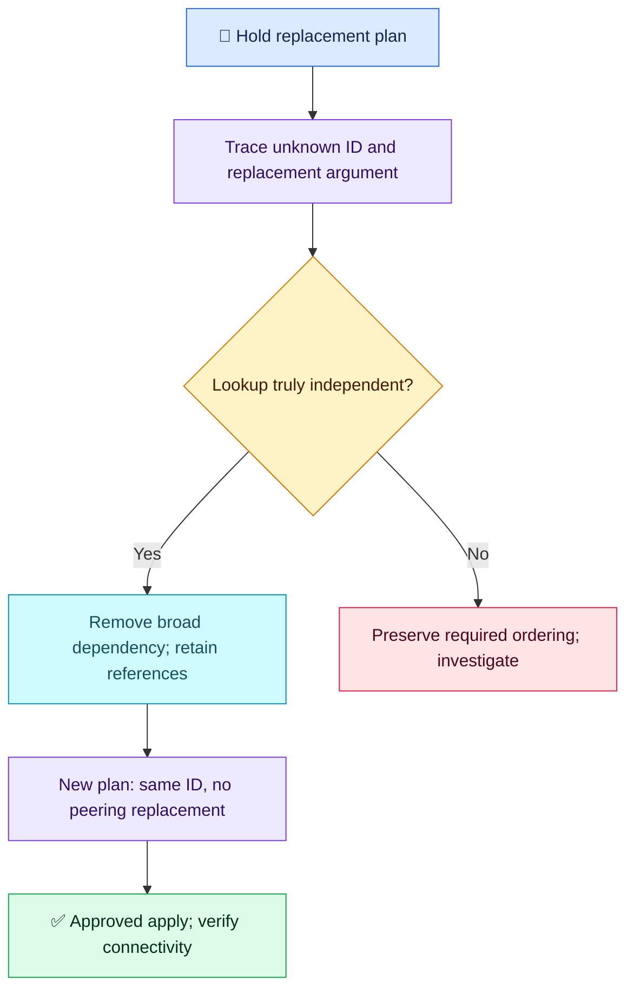

# Terraform Q11 — Deferred Lookup and Unnecessary Replacement

## 🎯 Scenario

An existing shared-services VPC is looked up by a fixed tag filter. Its data source has `depends_on = [module.application]`. A small application-module change defers the lookup until apply; the shared VPC ID becomes unknown and an existing peering connection is planned for replacement. Explain and safely correct the plan.

## ✅ Interview-ready answer

“The module-wide dependency delays an otherwise independent lookup when the module has pending changes. The unknown result flows into the peering's replacement-sensitive VPC ID. I would inspect the exact replacement argument, confirm the lookup genuinely has no dependency on the application change, and remove the unnecessary dependency. I would generate a new plan, verify the same shared VPC ID and no peering replacement, then apply only approved changes and verify connectivity.”

## 🧩 Focused configuration

Illustrative excerpt; retain the actual resource addresses, filters and other settings. The application module must expose its VPC ID as an output.

```hcl
data "aws_vpc" "shared" {
  filter {
    name   = "tag:Name"
    values = ["shared-services"]
  }
}

resource "aws_vpc_peering_connection" "shared" {
  vpc_id      = module.application.vpc_id
  peer_vpc_id = data.aws_vpc.shared.id
}
```

Attribute references retain the actual implicit dependencies. An independent shared-VPC lookup does not need to wait for every application-module operation. Keep explicit dependencies only when a genuine ordering requirement cannot be expressed through references.

```bash
terraform plan -out=tfplan
terraform show tfplan
# After approval of the newly generated plan only:
terraform apply tfplan
```

**Review:** trace the original `forces replacement` argument; in the new plan confirm the expected shared VPC ID, no peering destroy/create and only intended application changes. Do not apply the old replacement plan. If replacement persists, investigate other changed arguments or genuine dependencies rather than assuming the fix worked. After approved changes, verify peering status and application connectivity.

**Precision:** `depends_on` does not always make a lookup unknown; here the dependency has pending changes. Unknown does not mean changed, and not every unknown value forces replacement. In this scenario the provider plans replacement for a replacement-sensitive argument; do not assume apply will cancel that action when the ID resolves.



## Evaluation — 2026-10-18

**8.5/10 — Correct causal diagnosis and focused fix.** Interview Acceptance Probability: **80%**, subjective answer-specific coaching, not a hiring prediction. First of at most five focused follow-ups; four-year baseline.

**Attempt summary:** Identified unnecessary explicit dependency, delayed lookup, unknown shared VPC ID and immutable peering endpoints. Proposed removing the dependency and planning before applying, avoiding unnecessary recreation. Answer followed a simpler restatement of the same scenario, not a supplied solution.

**Credit:** Correctly connects dependency, unknown value and replacement; fixes the cause instead of masking it with lifecycle settings. Re-planning is explicitly credited. No penalty for absent HCL, command syntax or repeated CI gates.

**Deductions:** 0.5 for the absolute “never” know during planning (deferral here depends on pending upstream changes); 1 for incomplete concrete verification: inspect the triggering argument, confirm the expected ID/no replacement in the new plan and verify connectivity afterwards. These are one combined verification gap, not repeated penalties.

## Recovery from earlier gaps

| Earlier gap | Status | Evidence and limit |
| --- | --- | --- |
| Q06: unnecessary broad ordering | ✅ Resolved in this scenario | Identified and removed the independent lookup's module-wide dependency. |
| Q06: implicit references versus genuine hidden dependencies | 🟡 Partially improved | Explicit-dependency misuse understood; attribute-reference wiring and a legitimate hidden dependency were not demonstrated. Original fresh-environment/EC2 reasoning is not reassessed. |
| Q01: diagnose the actual replacement cause | ✅ Resolved in this scenario | Traced an unknown replacement-sensitive VPC ID instead of proposing ignore_changes. |
| Q01/Q06: concrete verification | 🟡 Partially improved | Re-plan proposed; exact acceptance evidence and post-change connectivity missing. |
| Q01 lifecycle semantics; other topic gaps | Not reassessed | No claim of full closure from a different scenario. |

Original Q01/Q06 scores remain unchanged. Keep their composite revision items open; resolved subskills are recorded separately.

## Sources

- [HashiCorp: data-source read timing](https://developer.hashicorp.com/terraform/language/data-sources)
- [HashiCorp: depends_on planning effects](https://developer.hashicorp.com/terraform/language/meta-arguments/depends_on)
